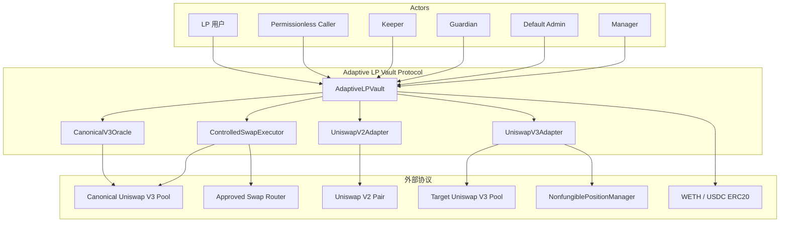
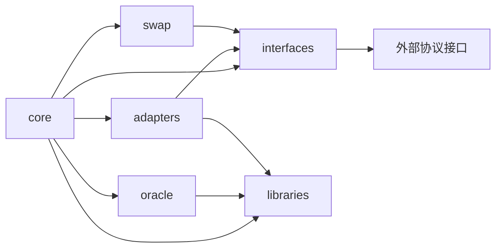
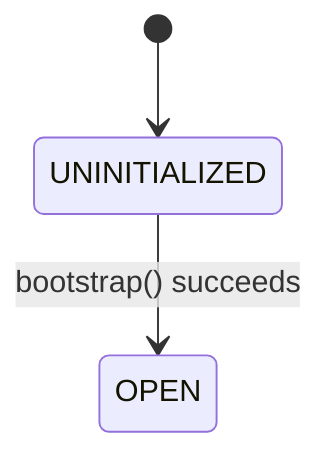
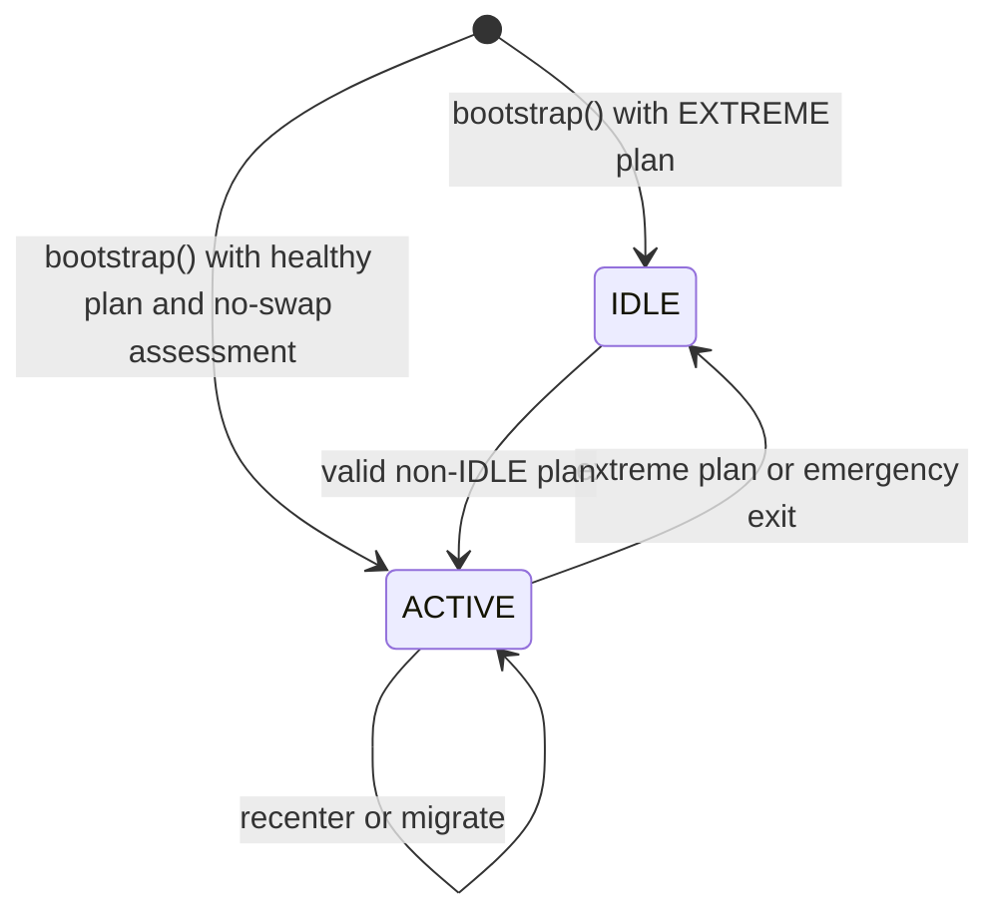

# Adaptive LP Vault 架构文档

- 文档版本：1.0
- 文档状态：实现规范
- 实现基线：Foundry + Solidity
- 对应产品文档：[PRODUCT_SPEC.md](PRODUCT_SPEC.md)
- 对应部署文档：[DEPLOYMENT.md](DEPLOYMENT.md)
- 代码状态：本文档中的目录、接口和类型为待实现设计，不表示仓库已有合约代码

本文档定义合约边界、依赖方向、存储模型、接口、错误、事件、调用时序和测试要求。产品规则以 [PRODUCT_SPEC.md](PRODUCT_SPEC.md) 为准；部署顺序、链下发布门禁、流动性预检和部署证据以 [DEPLOYMENT.md](DEPLOYMENT.md) 为准；文档中的名称必须保持一致。

## 1. 架构原则

1. `AdaptiveLPVault` 是唯一核心 Vault 部署合约，负责资产会计、计划生成、部署评估、状态机、资产转移和跨模块原子性；`VaultRoles`、`VaultPause` 与 `AdapterRegistry` 仅作为源码级抽象模块由其继承，不单独部署。
2. `CanonicalV3Oracle` 独立部署并由 Vault 固定绑定；`deviationBps` 在 Oracle 内部产生，不从调用者输入。
3. `IPositionAdapter` 隔离 Uniswap V2/V3 细节，Adapter 不能铸造或销毁 shares。
4. `ControlledSwapExecutor` 不是通用交易聚合器，只能按 Vault 验证过的 `SwapPlan` 执行 token0/token1 交换。
5. Registry 的遍历不是资产会计路径。Vault 只读取 `activeVenue` 对应 Adapter，保证 Gas 有界。
6. 所有资产迁移入口采用 Checks-Effects-Interactions、非重入保护和外部调用后的状态重读。

## 2. 系统边界



### 2.1 依赖方向

允许的依赖方向如下：



禁止以下依赖：

- `PriceMath` 不得依赖 Vault storage、`msg.sender`、Keeper 参数、Router 或 Adapter 外部调用；
- Adapter 直接铸造/销毁 shares 或修改 Vault 的策略状态；
- Oracle 读取目标 Venue 作为价格来源；
- Swap Executor 修改 `activeVenue`、shares 供应量或策略参数。

## 3. Foundry 项目目录

以下目录是规划中的实现结构，当前仓库未实现这些 Solidity 文件。

```text
AdaptiveLPVault/
├── foundry.toml
├── remappings.txt
├── src/
│   ├── core/
│   │   ├── AdaptiveLPVault.sol
│   │   ├── VaultRoles.sol
│   │   ├── VaultPause.sol
│   │   └── AdapterRegistry.sol
│   ├── oracle/
│   │   ├── CanonicalV3Oracle.sol
│   │   └── OracleTypes.sol
│   ├── adapters/
│   │   ├── UniswapV2Adapter.sol
│   │   ├── UniswapV3Adapter.sol
│   │   └── AdapterTypes.sol
│   ├── swap/
│   │   ├── ControlledSwapExecutor.sol
│   │   └── SwapTypes.sol
│   ├── interfaces/
│   │   ├── IAdaptiveLPVault.sol
│   │   ├── IVaultRoles.sol
│   │   ├── IVaultPause.sol
│   │   ├── IAdapterRegistry.sol
│   │   ├── ICanonicalV3Oracle.sol
│   │   ├── IPositionAdapter.sol
│   │   ├── IControlledSwapExecutor.sol
│   │   ├── IUniswapV2External.sol
│   │   └── IUniswapV3External.sol
│   └── libraries/
│       ├── PriceMath.sol
│       ├── PositionPlanHash.sol
│       └── SafeTransferLib.sol
├── test/
│   ├── unit/
│   │   ├── AdaptiveLPVault.t.sol
│   │   ├── CanonicalV3Oracle.t.sol
│   │   ├── UniswapV2Adapter.t.sol
│   │   ├── UniswapV3Adapter.t.sol
│   │   └── ControlledSwapExecutor.t.sol
│   ├── integration/
│   │   ├── DepositRedeem.t.sol
│   │   └── Rebalance.t.sol
│   ├── invariant/
│   │   ├── VaultInvariants.t.sol
│   │   └── AccountingInvariants.t.sol
│   ├── fork/
│   │   ├── MainnetOracle.t.sol
│   │   └── MainnetUniswapFlows.t.sol
│   ├── mocks/
│   └── helpers/
├── script/
│   ├── Deploy.s.sol
│   ├── Configure.s.sol
│   └── Bootstrap.s.sol
├── lib/
├── docs/
│   ├── PRODUCT_SPEC.md
│   ├── ARCHITECTURE.md
│   ├── SWAP_REBALANE_MATH.md
│   └── DEPLOYMENT.md
└── README.md
```

目录职责：


| 目录                 | 职责                                  | 约束                                                                                            |
| ------------------ | ----------------------------------- | --------------------------------------------------------------------------------------------- |
| `src/core`         | Vault 入口、角色、暂停、Adapter Registry、会计、计划和状态机 | `AdaptiveLPVault` 是唯一部署合约；其余为源码级抽象模块 |
| `src/oracle`       | 独立 Oracle、Uniswap V3 `observe`、报价和健康检查 | 由 Vault 固定绑定；不接受外部价格输入 |
| `src/libraries`    | Tick/价格换算、计划哈希和安全转账 | 无状态、无外部调用 |
| `src/adapters`     | V2/V3 Venue 适配与 Position 操作 | 只能由 Vault 调用资产方法 |
| `src/swap`         | 白名单 Router 和受限 Swap | 不得成为通用聚合器 |
| `src/interfaces`   | Vault、源码级模块和独立部署合约的逻辑接口契约 | 不包含实现状态；不以是否独立部署作为接口存在的前提 |
| `test/unit`        | 单模块行为 | Mock 外部依赖 |
| `test/integration` | 跨模块完整流程 | 覆盖原子回滚 |
| `test/invariant`   | 不变量和模糊测试 | 覆盖资产、shares、单活 Position |
| `test/fork`        | Mainnet/Fork 外部协议行为 | 验证真实 V2/V3 接口 |
| `script`           | 分阶段部署、角色指派、Adapter 绑定和一次性 Bootstrap | 必须实现 [DEPLOYMENT.md](DEPLOYMENT.md) 定义的链下阶段、发布门禁和证据要求；|
| `docs`             | 发布后的文档副本 | 以根目录规范为源；部署操作事实只在 `DEPLOYMENT.md` 维护 |


## 4. 核心类型与枚举

以下为 Solidity 类型契约的规范形状。字段名、顺序和语义不得在实现中无记录变更。

### 4.1 枚举

```solidity
enum VenueType {
    IDLE,
    UNISWAP_V2,
    UNISWAP_V3_LOW_FEE,
    UNISWAP_V3_HIGH_FEE
}

enum MarketRegime {
    LOW_DEVIATION,
    MEDIUM_DEVIATION,
    HIGH_DEVIATION,
    EXTREME_DEVIATION
}

enum PauseFlag {
    DEPOSIT,
    PLAIN_REBALANCE,
    SWAP_REBALANCE
}

enum SwapDirection {
    NONE,
    ZERO_FOR_ONE,
    ONE_FOR_ZERO
}
```

`VenueType` 描述资产位置，`MarketRegime` 描述 Vault 策略逻辑的市场状态，Oracle 健康性由 `OracleSnapshot.healthy` 独立表达；`PauseFlag` 描述暂停入口。`SwapDirection.NONE` 表示不需要 Swap，`ZERO_FOR_ONE` 表示 token0 → token1，`ONE_FOR_ZERO` 表示 token1 → token0。

### 4.2 部署配置类型

```solidity
struct VaultConfig {
    uint256 dustTolerance0;
    uint256 dustTolerance1;
    address canonicalOracle;
    address swapExecutor;
    uint256 minimumLockedShares;
    uint256 minimumInitialNav;
}

struct AccessControlConfig {
    uint48 initialDefaultAdminDelay;
    address initialDefaultAdmin;
}

struct StrategyConfig {
    uint32 minRebalanceCooldown;
    uint24 enterMediumBps;
    uint24 exitMediumBps;
    uint24 enterHighBps;
    uint24 exitHighBps;
    uint24 enterExtremeBps;
    uint24 exitExtremeBps;
    uint24 narrowRangeHalfWidthSteps;
    uint24 wideRangeHalfWidthSteps;
    uint16 minRecenterBps;
    uint16 maxHealthyIdleBps;
    uint16 maxSwapSlippageBps;
    uint16 maxMigrationLossBps;
}

struct OracleConfig {
    address canonicalPool;
    uint32 twapWindowSeconds;
    uint32 shortTwapWindowSeconds;
}

struct SwapExecutorConfig {
    address vault;
    address router;
    address swapPool;
}

struct PositionAdapterConfig {
    address vault;
    VenueType venue;
    address pool;
    address positionManager;
}
```

`VaultConfig`、`StrategyConfig`、`OracleConfig`、`SwapExecutorConfig` 和 `PositionAdapterConfig` 仅作为构造参数与内存传参结构，不作为整体状态变量写入普通 storage。各字段在部署时通过协议硬边界与字段关系校验后，分别写入所属合约的 Solidity `immutable` 状态变量；部署后任何角色均不得修改。

`CanonicalV3Oracle` 从 `OracleConfig.canonicalPool` 读取 Pool 原生有序的 `token0/token1`，再从两个 Token 合约读取 `IERC20Metadata.decimals()`；Token 地址必须非零、互不相同并满足 `token0 < token1`，两个 decimals 均不得大于 18。Token metadata 调用失败或返回值超限时拒绝部署。

`ControlledSwapExecutor` 使用 `SwapExecutorConfig` 固定唯一可调用它的 `vault`、白名单 `router` 和 `swapPool`。Executor 从 `swapPool` 派生有序的 `token0/token1` 与 `feeTier`，并验证 Pool、Router、Factory 和代码绑定；并验证`swapPool == canonicalOracle.canonicalPool()`。v1 的 exact-input、single-hop `swapMethod` 由实现固定，不允许通过部署配置选择或在部署后替换。

`UniswapV2Adapter` 和 `UniswapV3Adapter` 使用 `PositionAdapterConfig` 固定 `vault`、`venue` 与 `pool`，并从绑定 Pool 派生有序的 `token0/token1`。V2 配置的 `venue` 必须为 `UNISWAP_V2`、`positionManager` 必须为零地址，且 `feeTier/tickSpacing` 固定为零；V3 配置的 `venue` 必须为对应的 Low-Fee 或 High-Fee Venue、`positionManager` 必须为非零地址，`feeTier/tickSpacing` 从 Pool 读取并验证。所有这些绑定在 Adapter 部署后均不可替换。

`AdaptiveLPVault` 从 `canonicalOracle` 的只读绑定中取得 `canonicalPool`、`token0/token1` 和 `token0Decimals/token1Decimals`，校验这些值与 canonical Pool 的实际有序资产和 Token metadata 一致后分别缓存为 immutable；同时读取 `swapExecutor.swapPool()` 并要求其与 `canonicalPool` 地址相同。`VaultConfig` 不重复接收这些派生值。

`AccessControlConfig` 仅作为 Vault 构造参数传入 OpenZeppelin Contracts v5 `AccessControlDefaultAdminRules`。`initialDefaultAdmin` 必须非零；`initialDefaultAdminDelay` 是根管理员转移的初始等待时间，应在部署前校准，Mainnet 部署应采用非零值。

### 4.3 Oracle 与资产快照

```solidity
struct OracleSnapshot {
    int24 spotTick;
    int24 twapTick;
    int24 shortTwapTick;
    uint256 spotPriceToken1;
    uint256 twapPriceToken1;
    uint256 shortTwapPriceToken1;
    uint256 deviationBps;
    uint32 twapWindowSeconds;
    uint32 shortTwapWindowSeconds;
    uint32 observedAt;
    bool healthy;
}

struct AssetSnapshot {
    uint256 idle0;
    uint256 idle1;
    uint256 position0;
    uint256 position1;
    uint256 total0;
    uint256 total1;
    uint256 totalShares;
}

struct PositionSnapshot {
    VenueType venue;
    address adapter;
    uint256 principal0;
    uint256 principal1;
    uint256 claimableFee0;
    uint256 claimableFee1;
    uint256 amount0;
    uint256 amount1;
    uint256 liquidity;
    uint256 positionId;
    int24 tickLower;
    int24 tickUpper;
}
```

`amount0/amount1` 必须等于 `principal + claimableFee` 的唯一会计结果。费用归集后，Adapter 必须重新读取并返回新的快照。

### 4.4 Position Plan、Assess Deployment 与 Swap Plan

```solidity
struct PositionPlan {
    bytes32 planHash;
    VenueType targetVenue;
    MarketRegime marketRegime;
    int24 tickLower;
    int24 tickUpper;
    uint64 version;
}

struct DeploymentAssessment {
    bool requiresSwap;
    SwapDirection direction;
}

struct SwapPlan {
    SwapDirection direction;
    uint256 amountIn;
    uint256 minAmountOut;
    uint32 deadline;
}
```

- `PositionPlan.targetVenue`、`marketRegime` 与 Tick 字段的业务语义和规范化生成规则以 [PRODUCT_SPEC.md](PRODUCT_SPEC.md) §9.1.2–§9.1.3 为唯一来源，本节不重复定义。
- `PositionPlan.planHash` 不包含 `planHash` 自身，固定按 `keccak256(abi.encode(uint8(targetVenue), uint8(marketRegime), tickLower, tickUpper, version))` 计算；字段顺序和 Solidity 类型依次为 `uint8`、`uint8`、`int24`、`int24`、`uint64`。
- `DeploymentAssessment` 是 Vault 根据当前资产和目标 Adapter 生成的临时内存结果，仅包含 `requiresSwap` 与 `direction`，不写入 `lastExecutedPlan` storage。
- `SwapPlan` 是 Vault 在执行入口内构造、仅传给 `ControlledSwapExecutor` 的交易级对象，不是调用者可自由提交的完整目标结构。
- `deadline` 由调用入口独立校验；调用者不能传入任意目标字段、Router、实际方向或 calldata。

### 4.5 运行时控制状态

```solidity
struct PauseState {
    bool depositPaused;
    bool plainRebalancePaused;
    bool swapRebalancePaused;
}
```

`PauseState` 是 `VaultPause` 的运行时控制状态；其内部 storage 由 `VaultPause` 逻辑读写，最终位于 `AdaptiveLPVault` 的部署地址。

### 4.6 Registry 绑定类型

```solidity
struct AdapterConfig {
    VenueType venue;
    address adapter;
    int24 tickSpacing;
    bool enabled;
}
```

`AdapterConfig` 归属于 Vault 继承的 `AdapterRegistry`，是 `_adapterByVenue` Mapping 的值类型。`venue` 必须与 Mapping Key 一致；`tickSpacing` 是配置时从 Adapter 绑定读取并验证后写入的缓存，V2 Venue 固定为零。Bootstrap 成功后 Adapter 身份字段和 spacing 缓存冻结，只有 `enabled` 可以继续修改。

## 5. 存储归属与状态转换

### 5.1 Vault 存储

`AdaptiveLPVault` 至少保存：


| 存储项                                             | 类型             | 存储方式        | 写入时机                               | 约束                                                 |
| ----------------------------------------------- | -------------- | ----------- | ---------------------------------- | -------------------------------------------------- |
| `token0/token1`                                 | `address`      | `immutable` | 构造                                 | 从 canonical Oracle/canonical Pool 派生的固定有序资产对；部署后不可修改                       |
| `token0Decimals/token1Decimals`                 | `uint8`        | `immutable` | 构造                                 | 从固定 Token 的 `decimals()` 派生且均不超过 18；部署后不可修改               |
| `dustTolerance0/dustTolerance1`                 | `uint256`      | `immutable` | 构造                                 | 仅用于整数舍入和最小单位容忍；部署后不可修改                             |
| `canonicalOracle`                               | `address`      | `immutable` | 构造                                 | 固定 `CanonicalV3Oracle` 合约；部署后不可替换                  |
| `swapExecutor`                                  | `address`      | `immutable` | 构造                                 | 固定 `ControlledSwapExecutor` 合约；部署后不可替换             |
| `minimumLockedShares`                           | `uint256`      | `immutable` | 构造                                 | Bootstrap 时铸造给 Vault 自身，永久锁定                       |
| `minimumInitialNav`                             | `uint256`      | `immutable` | 构造                                 | Bootstrap 最低 NAV；调用者不能覆盖                           |
| `minRebalanceCooldown`                          | `uint32`       | `immutable` | 构造                                 | 单位为秒；部署时校验，部署后不可修改                                  |
| `enterMediumBps/exitMediumBps`                  | `uint24`       | `immutable` | 构造                                 | 满足完整 Hysteresis 阈值关系；部署后不可修改                       |
| `enterHighBps/exitHighBps`                      | `uint24`       | `immutable` | 构造                                 | 满足完整 Hysteresis 阈值关系；部署后不可修改                       |
| `enterExtremeBps/exitExtremeBps`                | `uint24`       | `immutable` | 构造                                 | 满足完整 Hysteresis 阈值关系；部署后不可修改                       |
| `narrowRangeHalfWidthSteps/wideRangeHalfWidthSteps` | `uint24`        | `immutable` | 构造                                 | spacing 步数；部署后不可修改                           |
| `minRecenterBps/maxHealthyIdleBps`                | `uint16`       | `immutable` | 构造                                 | `maxHealthyIdleBps <= BPS`；`minDeployBps` 由 `BPS - maxHealthyIdleBps` 派生储                                |
| `maxSwapSlippageBps/maxMigrationLossBps`        | `uint16`       | `immutable` | 构造                                 | 不超过协议硬上限；部署后不可修改                                   |
| `initialized`                                   | `bool`         | `storage`   | Bootstrap 成功                       | 只能从 false 到 true                                   |
| `activeVenue`                                   | `VenueType`    | `storage`   | Bootstrap/Rebalance/Emergency Exit | 与有效 Position 一致                                    |
| `lastPositionChangeAt`                           | `uint32`       | `storage`   | Bootstrap、两类 Rebalance 成功 | 初始为 0；两类 Rebalance 共用其 Cooldown；Emergency Exit 跳过检查且不更新；失败交易和 IDLE 幂等分支不更新 |
| `planVersion`                                   | `uint64`       | `storage`   | 成功 Position 结构变化                   | 初始为 0；每次成功变化递增 1，失败交易不更新                           |
| `lastExecutedPlan`                              | `PositionPlan` | `storage`   | Bootstrap/成功策略计划执行                 | 保存最近一次成功执行的策略计划；其 `marketRegime` 是 Hysteresis 历史，非策略 Position 变化后可与当前资产位置不同 |


Vault 不单独保存 `activeAdapter`；当前 Adapter 是由 `activeVenue` 和 Bootstrap 后冻结的 Registry 绑定派生的唯一结果。`activeVenue != IDLE` 时使用 `getAdapter(activeVenue)`，`activeVenue == IDLE` 时 `getAdapter(IDLE)` 返回 `address(0)`，且不得调用任何 Adapter。

Vault 不保存由 Registry 遍历产生的冗余资产总额。`totalAssets()` 每次读取 Idle 余额和 `activeVenue` 对应 Adapter 的快照，并在 `AdaptiveLPVault` 内部计算；IDLE 时 Position 资产为零且不读取 Adapter。

### 5.2 VaultPause 存储

`VaultPause` 是由 `AdaptiveLPVault` 继承的源码级抽象模块，不单独部署。其逻辑上只负责以下持久化状态：

| 存储项        | 类型         | 存储方式       | 写入时机                         | 约束                         |
| ----------- | ---------- | ---------- | ---------------------------- | -------------------------- |
| `_pauseState` | `PauseState` | 普通 `storage` | `setPauseState` 或 Emergency Exit | 初始为全 false；Redeem 不受影响 |

`pauseState()` 从 `_pauseState` 返回当前暂停状态；`setPauseState()` 和 Emergency Exit 通过 `VaultPause` 的内部逻辑更新该状态。`VaultPause` 不保存其他业务状态。

### 5.3 Oracle 配置存储

`CanonicalV3Oracle` 是独立部署的 Oracle 合约：


| 存储项                      | 类型       | 存储方式        | 写入时机      | 约束                                                       |
| ------------------------ | -------- | ----------- | --------- | -------------------------------------------------------- |
| `canonicalPool`          | `address` | `immutable` | Oracle 构造 | 固定 canonical Uniswap V3 Pool；部署后不可替换                      |
| `token0/token1`          | `address` | `immutable` | Oracle 构造 | 从 canonical Pool 读取的有序 Token；必须非零、互不相同且 `token0 < token1`；部署后不可替换 |
| `token0Decimals/token1Decimals` | `uint8` | `immutable` | Oracle 构造 | 从对应 Token `decimals()` 读取且均不超过 18；部署后不可替换 |
| `twapWindowSeconds`      | `uint32` | `immutable` | Oracle 构造 | 大于零且不超过协议硬上限；部署后不可修改                                     |
| `shortTwapWindowSeconds` | `uint32` | `immutable` | Oracle 构造 | `0 < shortTwapWindowSeconds < twapWindowSeconds`；部署后不可修改 |


Oracle 在构造时完成 canonical Pool 代码与 Factory 绑定、有序 Token 地址、Token metadata、窗口关系和协议硬边界校验。实现可以使用独立的 `immutable` 字段承载，而不要求把整个 `OracleConfig` 结构体写入普通 storage。

### 5.4 Registry 存储

`AdapterRegistry` 是 `AdaptiveLPVault` 继承的内部存储与校验模块。


| 存储项               | 类型                                    | 存储方式                 | 写入时机                                                             | 约束                               |
| ----------------- | ------------------------------------- | -------------------- | ---------------------------------------------------------------- | -------------------------------- |
| `_adapterByVenue` | `mapping(VenueType => AdapterConfig)` | 普通 `storage` Mapping | `configureAdapter` 写入 Adapter 地址和经过验证的 `tickSpacing` 并将 `enabled` 设为 true；Bootstrap 后 `setAdapterEnabled` 仅修改 `enabled` | Key 只允许三个非 IDLE Venue；不得用于遍历资产会计 |


`adapter == address(0)` 表示该 Venue 未注册。`IDLE` 不是 Adapter，`_adapterByVenue[IDLE]` 必须保持零值，`getAdapter(IDLE)` 返回 `address(0)`，`isEnterEnabled(IDLE)` 返回 `false`。`isEnterEnabled(venue)` 仅按 `adapter != address(0) && enabled` 派生 Registry 层结果；其他入口门控由 Vault 负责。`tickSpacing` 是经过验证、供 Vault 策略逻辑读取的缓存；

### 5.5 Adapter 合约存储

`UniswapV2Adapter` 和 `UniswapV3Adapter` 是独立部署的 Adapter 合约；每个 Adapter 至少保存以下不可变绑定字段：


| 存储项             | 类型          | 存储方式        | 写入时机       | 约束                                   |
| --------------- | ----------- | ----------- | ---------- | ------------------------------------ |
| `vault`         | `address`   | `immutable` | Adapter 构造 | 只有该 Vault 可以调用资产变更方法；部署后不可替换         |
| `venue`         | `VenueType` | `immutable` | Adapter 构造 | 必须与 Adapter 实现及 Registry 注册 Venue 一致 |
| `pool`          | `address`   | `immutable` | Adapter 构造 | 固定绑定的 V2 Pair 或 V3 Pool；部署后不可替换      |
| `token0/token1` | `address`   | `immutable` | Adapter 构造 | 从绑定 Pool 读取的有序 Token；必须与 Vault 固定资产及顺序一致；部署后不可替换          |
| `feeTier`       | `uint24`    | `immutable` | Adapter 构造 | V3 必须与 Pool Fee Tier 一致；V2 固定为零      |
| `tickSpacing`   | `int24`     | `immutable` | Adapter 构造 | V3 必须与 Pool `tickSpacing()` 一致；V2 固定为零 |


V3 Adapter 还保存：


| 存储项               | 类型        | 存储方式        | 写入时机              | 约束                                              |
| ----------------- | --------- | ----------- | ----------------- | ----------------------------------------------- |
| `positionManager` | `address` | `immutable` | Adapter 构造        | 固定的 NonfungiblePositionManager；部署后不可替换          |
| `positionId`      | `uint256` | `storage`   | 创建 Position 或完整退出 | 无有效 NFT Position 时为零；同一 Adapter 最多一个有效 Position |


### 5.6 ControlledSwapExecutor 合约存储

`ControlledSwapExecutor` 是独立部署的 Swap 执行合约；其固定依赖和调用权限不属于 Vault 或 Registry 的存储。Executor 至少保存以下部署时固定的绑定字段：


| 存储项             | 类型                     | 存储方式        | 写入时机        | 约束                                     |
| --------------- | ---------------------- | ----------- | ----------- | -------------------------------------- |
| `vault`         | `address`              | `immutable` | Executor 构造 | 只有该 Vault 可以调用 `executeSwap()`；部署后不可替换 |
| `router`        | `address`              | `immutable` | Executor 构造 | 固定白名单 Router；部署后不可替换                   |
| `token0/token1` | `address`              | `immutable` | Executor 构造 | 从绑定 `swapPool` 读取的有序 Token；必须与 Vault 固定资产及顺序一致；部署后不可替换              |
| `swapPool`      | `address`              | `immutable` | Executor 构造 | 固定批准使用的 Swap Pool；必须与 Vault 的 canonical Pool 为同一地址；部署后不可替换              |
| `feeTier`       | `uint24`               | `immutable` | Executor 构造 | 必须与 `swapPool` 的 Fee Tier 一致；部署后不可替换   |
| `swapMethod`    | 固定代码逻辑或 `immutable` 枚举 | 部署时固定       | Executor 构造 | 仅允许 v1 规定的 exact-input、single-hop 方法   |


Executor 不存储独立的 Swap recipient 或持久 Router allowance；

### 5.7 状态转换约束

Vault 的生命周期、资产位置和运行时控制彼此独立。

生命周期仅由 `initialized` 表达：



已初始化 Vault 的资产位置仍由 `activeVenue` 表达：



`PAUSED` 不是生命周期或资产位置。暂停开关、Adapter 进入状态、Oracle 健康状态、当前资产位置和 `lastExecutedPlan.marketRegime` 表示的 Hysteresis 历史彼此独立；单独改变这些运行时控制不得触发生命周期或资产位置转换。
## 6. 接口契约


### 6.1 Vault 接口

```solidity
interface IAdaptiveLPVault is IVaultRoles, IVaultPause, IAdapterRegistry {
    function bootstrap(uint256 amount0, uint256 amount1, address receiver) external;

    function deposit(
        uint256 amount0Max,
        uint256 amount1Max,
        uint256 minSharesOut,
        address receiver
    ) external returns (uint256 amount0Used, uint256 amount1Used, uint256 sharesMinted);

    function redeem(
        uint256 shares,
        uint256 minAmount0Out,
        uint256 minAmount1Out,
        address receiver,
        address owner
    ) external returns (uint256 amount0Out, uint256 amount1Out);

    function rebalance(bytes32 expectedPlanHash, uint32 deadline) external;

    function rebalanceWithSwap(
        bytes32 expectedPlanHash,
        SwapDirection expectedDirection,
        uint256 amountIn,
        uint256 keeperMinAmountOut,
        uint32 deadline
    ) external;

    function emergencyExitToIdle() external;

    function previewRebalance()
        external
        view
        returns (PositionPlan memory plan, DeploymentAssessment memory assessment);

    function totalAssets() external view returns (uint256 total0, uint256 total1);
    function assetSnapshot() external view returns (AssetSnapshot memory);
    function lastExecutedPlan() external view returns (PositionPlan memory);
}
```

`IAdaptiveLPVault` 只声明 Vault 自身的核心业务入口，并通过继承聚合 `IVaultRoles`、`IVaultPause` 和 `IAdapterRegistry`。它描述的是源码接口组合，不是独立部署合约；编译后的 Vault ABI 是这些接口和实现中全部外部函数的聚合结果。

#### Vault 内部计划与部署评估

```solidity
function _getPlan(
    OracleSnapshot memory oracle,
    AssetSnapshot memory assets,
    PositionSnapshot memory currentPosition,
    uint8 token0Decimals,
    uint8 token1Decimals,
    VenueType currentVenue,
    MarketRegime lastExecutedRegime,
    StrategyConfig memory strategyConfig,
    int24 lowFeeTickSpacing,
    int24 highFeeTickSpacing,
    uint64 currentVersion
) internal pure returns (PositionPlan memory plan);

function _assessDeployment(
    PositionPlan memory plan,
    uint256 amount0,
    uint256 amount1,
    int24 twapTick
) internal view returns (DeploymentAssessment memory assessment);
```

- `_getPlan()` 显式接收 `OracleSnapshot`、`AssetSnapshot`、`PositionSnapshot`、Token decimals、当前 Venue、最近一次已执行 Regime、固定策略参数、两个 V3 Pool 的 `tickSpacing` 和当前版本；策略所需的 NAV 与 Idle 比例在函数内按同一次 `twapTick` 即时计算；
- `_assessDeployment()` 属于 Vault 的内部 `view` 编排职责，直接调用目标 Adapter 的 `previewDeposit()`，使用局部 `used0/used1` 计算 `requiresSwap` 和 `direction`；
- `PriceMath`、`PositionPlanHash` 和 `SafeTransferLib` 仅提供跨模块通用的无状态工具。

### 6.2 Vault Roles 接口

```solidity
interface IVaultRoles is IAccessControlDefaultAdminRules {
    function DEFAULT_ADMIN_ROLE() external view returns (bytes32);
    function MANAGER_ROLE() external view returns (bytes32);
    function KEEPER_ROLE() external view returns (bytes32);
    function GUARDIAN_ROLE() external view returns (bytes32);
}
```

`VaultRoles` 是 `AccessControlDefaultAdminRules` 的抽象实现模块，并实现 `IVaultRoles`。它负责 Default Admin 构造流程、业务角色常量和权限校验；

### 6.3 Vault Pause 接口

```solidity
interface IVaultPause {
    function pauseState() external view returns (PauseState memory);
    function setPauseState(PauseState calldata newState) external;
}
```

`VaultPause` 是 `IVaultPause` 的抽象实现模块，负责 `pauseState` storage、Manager/Guardian 权限校验和暂停状态变更。

### 6.4 Oracle 接口

```solidity
interface ICanonicalV3Oracle {
    function snapshot() external view returns (OracleSnapshot memory);
    function quoteToken0InToken1(uint256 amount0, int24 tick, bool roundUp)
        external
        view
        returns (uint256 amount1);
    function quoteToken1InToken0(uint256 amount1, int24 tick, bool roundUp)
        external
        view
        returns (uint256 amount0);
    function isHealthy() external view returns (bool);
    function canonicalPool() external view returns (address);
    function token0() external view returns (address);
    function token1() external view returns (address);
    function token0Decimals() external view returns (uint8);
    function token1Decimals() external view returns (uint8);
}
```

Oracle 架构边界：

- `snapshot()` 只从部署时绑定且已验证的 canonical Pool 读取数据；三个 Tick 和三个规范化价格字段均使用 Pool/Vault 统一的有序 Token 顺序，不得使用目标 Venue 或调用者提供的替代价格；
- `quoteToken0InToken1()` 和 `quoteToken1InToken0()` 使用固定的 Vault Token 顺序和全精度数学；`roundUp == false` 时向下取整，`roundUp == true` 时向上取整；
- `token0/token1` 和 decimals 由 canonical Pool 及其 Token metadata 派生并以 immutable 暴露；Vault 在构造时校验这些绑定；
- Oracle 负责输出 `OracleSnapshot` 和健康状态，不负责决定策略状态或目标 Venue；Observation 历史不足或必要 Pool 读取与动态价格计算失败时，`snapshot()` 返回 `healthy == false`，不得让对应底层错误穿透回滚；

### 6.5 Adapter Registry 接口

```solidity
interface IAdapterRegistry {
    function configureAdapter(VenueType venue, address adapter) external;
    function getAdapter(VenueType venue) external view returns (address adapter);
    function getConfig(VenueType venue) external view returns (AdapterConfig memory);
    function isEnterEnabled(VenueType venue) external view returns (bool);
    function setAdapterEnabled(VenueType venue, bool enabled) external;
}
```

`IAdapterRegistry` 由 `AdaptiveLPVault` 在 Vault 同一地址上实现，不代表独立部署合约。

Registry 架构边界：

- `configureAdapter()` 只接受已独立部署的 Adapter 地址；Vault 从 Adapter 读取绑定信息，要求 Adapter 与其 Pool 的 `token0/token1` 都按地址升序且与 Vault 的有序资产完全一致，再完成其他绑定校验并写入 Adapter 地址、`tickSpacing` 缓存和 `enabled = true`；
- `configureAdapter()` 仅在 Bootstrap 前开放并可重复调用；该方法不部署 Adapter、不转移资产、不创建 Position；
- Bootstrap 成功时重新验证 Adapter 的 immutable 绑定与 Registry 的 `tickSpacing` 缓存并冻结身份字段；此后 `setAdapterEnabled()` 只能修改 `enabled`；

### 6.6 Adapter 接口

```solidity
interface IPositionAdapter {
    function vault() external view returns (address);
    function venue() external view returns (VenueType);
    function pool() external view returns (address);
    function token0() external view returns (address);
    function token1() external view returns (address);
    function feeTier() external view returns (uint24);
    function tickSpacing() external view returns (int24);
    function snapshot() external view returns (PositionSnapshot memory);
    function syncFees() external returns (uint256 fee0, uint256 fee1);
    function previewDeposit(uint256 amount0Max, uint256 amount1Max, PositionPlan calldata plan)
        external
        view
        returns (uint256 used0, uint256 used1);
    function deposit(uint256 amount0Max, uint256 amount1Max, PositionPlan calldata plan)
        external
        returns (uint256 used0, uint256 used1, uint256 liquidity);
    function withdraw(uint256 shares, uint256 totalShares)
        external
        returns (uint256 amount0, uint256 amount1);
    function withdrawAll() external returns (uint256 amount0, uint256 amount1);
}
```

Adapter 架构边界：

- `vault()`、`venue()`、`pool()`、`token0()`、`token1()`、`feeTier()` 和 `tickSpacing()` 返回 Adapter 部署时固定的绑定信息；Adapter 的 `token0/token1` 从绑定 Pool 读取，必须按地址升序且与 Vault 的有序资产完全一致；V2 Adapter 的 `feeTier()` 和 `tickSpacing()` 固定返回零；
- 所有资产变更方法只接受 Vault 调用；Adapter 不铸造或销毁 shares，也不修改 Vault 的策略状态；
- `previewDeposit()` 必须只读，并与真实 `deposit()` 使用一致的底层 AMM 计算路径；Deposit 比例使用当前 Position Snapshot 的 `principal0/principal1`，`amount0Max/amount1Max` 是使用上限，返回的 `used0/used1` 是实际使用数量；
- Vault 仅可在非 IDLE 目标满足 `isEnterEnabled(targetVenue) == true` 后调用 `previewDeposit()` 或 `deposit()`；用户 Deposit 使用当前 `activeVenue` 作为目标；
- `snapshot()` 返回完整的 Position 资产快照，费用和本金不得在同一会计路径中重复计价；
- `withdraw(shares, totalShares)` 的 `totalShares` 必须是本次销毁前 Vault 总供应量。V2 Adapter 以 `floor(LPBalanceBefore × shares / totalShares)` 计算并销毁 LP Token；V3 Adapter 以 `floor(liquidityBefore × shares / totalShares)` 计算并移除 liquidity。原生 Position 单位取整结果为零时必须返回 `0/0`，不得向上取整或改为完整退出；
- `withdraw()` 返回的 `amount0/amount1` 必须是底层 AMM 退出并转入 Vault 的实际 token0/token1 数量；Vault 必须以调用前后余额增量验证两个返回值。Redeem 的 Idle 分配以调用 `withdraw()` 前的 Vault 余额为基准，禁止把本次 Position 退出所得再次计入 Idle 份额；
- `snapshot()`、`syncFees()`、`withdraw()` 和 `withdrawAll()` 不受 Adapter `enabled` 限制，并必须继续支持已禁用 Active Adapter 的计价和退出；`withdraw()` 和 `withdrawAll()` 必须将资产返回 Vault 控制的地址；

### 6.7 Swap Executor 接口

```solidity
interface IControlledSwapExecutor {
    function executeSwap(SwapPlan calldata plan)
        external
        returns (uint256 amountOut);

    function router() external view returns (address);
    function vault() external view returns (address);
    function token0() external view returns (address);
    function token1() external view returns (address);
    function swapPool() external view returns (address);
    function feeTier() external view returns (uint24);
}
```

ControlledSwapExecutor 架构边界：

- `vault`、Router、`swapPool`、Fee Tier 和固定 Swap 方法在部署时固定，Bootstrap 后不能由 Keeper/Manager 替换；`swapPool` 必须与 `canonicalOracle.canonicalPool()` 为同一地址，Executor 的 `token0/token1` 从该 Pool 读取并按地址升序，且与 Vault/canonical Pool 的有序资产完全一致；
- Executor 只接受 Vault 调用，只执行 `SwapPlan` 指定的交易级参数和局部 Swap 安全检查；
- Executor 不调用 Vault 策略逻辑，不退出或建立 Position，也不负责完整迁移损失、部署率、Idle 或单活 Position 的后置校验；这些检查由 Vault 负责；


## 7. 错误契约

错误使用 custom error，错误参数只能包含帮助调用者修正请求所需的信息，不得泄露可被用来绕过权限或安全限制的内部假设。Vault 自定义错误名和触发语义固定如下。

继承错误沿用 OpenZeppelin 标准语义：角色授权和 `renounceRole` 调用者确认失败分别使用 `IAccessControl` 的 `AccessControlUnauthorizedAccount` 与 `AccessControlBadConfirmation`；非法根管理员、绕过单一根管理员或两阶段规则以及尚未满足延迟的操作，分别使用 `IAccessControlDefaultAdminRules` 的 `AccessControlInvalidDefaultAdmin`、`AccessControlEnforcedDefaultAdminRules` 和 `AccessControlEnforcedDefaultAdminDelay`，Vault 不定义额外的最后管理员错误或自定义根管理员计数错误。`redeem` 在 `owner` shares 余额不足或代赎 allowance 不足时，分别使用 `IERC20Errors` 的 `ERC20InsufficientBalance` 与 `ERC20InsufficientAllowance`；

```solidity
/// @notice 仅允许初始化前调用的入口在 Vault 已初始化后被调用。
error AlreadyInitialized();

/// @notice 要求已初始化状态的入口在 Vault 尚未初始化时被调用。
/// @dev 适用于 deposit、redeem、rebalance、rebalanceWithSwap、setPauseState、setAdapterEnabled、emergencyExitToIdle 和 previewRebalance。
/// @dev 无角色入口首先执行本检查；角色门控入口先校验角色，再立即执行本检查。
error NotInitialized();

/// @notice Guardian 尝试把任一暂停位从 true 改为 false。
error GuardianCannotUnpause();

/// @notice 调用所需入口当前处于暂停状态。
/// @param flag 阻止本次调用的暂停位。
error Paused(PauseFlag flag);

/// @notice Bootstrap、Deposit、Preview 或两类 Rebalance 的 Oracle 健康门控失败。
/// @dev 该错误路径不得生成或返回 PositionPlan。
error OracleUnhealthy();

/// @notice 组件或 Pool 的有序 Token 地址与 Vault 固定的 token0/token1 不一致。
error InvalidAssetPair();

/// @notice ControlledSwapExecutor 绑定的 Swap Pool 不是 Vault 的 canonical Pool。
error InvalidSwapPool();

/// @notice Pool 的 token0/token1 地址为空、相同或未按地址升序排列。
error InvalidTokenOrder();

/// @notice 无法读取 Token 的 decimals 元数据。
/// @param token 无法读取元数据的 Token。
error InvalidTokenMetadata(address token);

/// @notice Token 的链上 decimals 超过 18。
/// @param token 校验失败的 Token。
/// @param actual IERC20Metadata.decimals() 返回的 decimals。
error InvalidTokenDecimals(address token, uint8 actual);

/// @notice Bootstrap 的初始 NAV 低于 minimumInitialNav。
error MinimumNavNotMet();

/// @notice 双边 Active Position 下计算出的实际存款 d0 或 d1 为零。
error ZeroAmount();

/// @notice V3 Active Position 的 principal0 或 principal1 为零，不能接受 Deposit。
error ActivePositionSingleSided();

/// @notice 执行时计算出的 sharesMinted 低于调用者指定的 minSharesOut。
/// @param actual 实际计算出的 sharesMinted。
/// @param minimum 调用者要求的最小 shares 输出。
error SharesSlippage(uint256 actual, uint256 minimum);

/// @notice Redeem 的实际双资产输出未同时满足调用者指定的最小输出。
/// @param amount0 实际 token0 输出。
/// @param amount1 实际 token1 输出。
error AssetSlippage(uint256 amount0, uint256 amount1);

/// @notice Adapter 的 withdraw 返回值与 Vault 在调用期间收到的 token0/token1 实际余额增量不一致。
error AdapterBalanceMismatch();

/// @notice 当前重新生成的 PositionPlan 哈希与 expectedPlanHash 不一致。
error InvalidPlanHash();

/// @notice Swap 方向为 NONE，或与当前部署评估派生的方向不一致。
error InvalidSwapDirection();

/// @notice Adapter 绑定缺少有效 V3 tickSpacing、spacing 非正值或与 Pool 不一致。
error InvalidTickSpacing();

/// @notice spacing 步数换算溢出、Range 边界不合法或生成的 Range 超出 Uniswap V3 可用 Tick。
error InvalidTickRange();

/// @notice 当前区块时间已经超过调用者指定的 deadline。
error DeadlineExpired();

/// @notice 计划生成的状态或 Range 与当前状态相同，无需执行变更。
error NoStateChangeRequired();

/// @notice 计划性 Rebalance 的最小冷却时间尚未结束。
/// @param availableAt 允许再次执行计划性 Rebalance 的最早时间。
/// @dev 两类 Rebalance 均使用该错误；Emergency Exit 不受此限制。
error CooldownActive(uint256 availableAt);

/// @notice Bootstrap 或普通 rebalance 的部署评估表明必须先执行 Swap。
/// @dev 这是通过 revert data 返回的 custom error，不是事件。
error SwapRequired();

/// @notice 当前入口、计划或部署评估不允许执行 Swap。
error SwapNotAllowed();

/// @notice Swap 使用的 Router 不是 Executor 部署时封存的 Router。
error RouterNotAllowed();

/// @notice Swap 涉及的 Token 不属于 Vault 固定的 token0/token1，或与方向不一致。
error TokenNotAllowed();

/// @notice amountIn 超过本次过量资产修复允许使用的最大数量。
error SwapAmountExceeded();

/// @notice Swap 的实际输出低于本次 SwapPlan 的 minAmountOut。
error SwapSlippage();

/// @notice 完整迁移后的 NAV 损失超过 maxMigrationLossBps。
error MigrationLossExceeded();

/// @notice Deposit 或 Rebalance 后的 Idle 比例超过 maxHealthyIdleBps。
error IdleLimitExceeded();

/// @notice 目标 Position 的最差结果模拟部署率或最终实际部署率低于派生的 minDeployBps。
error DeploymentRatioTooLow();

/// @notice 建立目标 Position 前仍存在另一有效 Position。
error ActivePositionExists();

/// @notice 退出后旧 Position 的 liquidity 或资产状态未完全清空。
error PositionNotCleared();

/// @notice 请求的非 IDLE Venue 尚未绑定 Adapter。
error AdapterNotRegistered();

/// @notice 当前 Active Adapter 或非 IDLE 候选目标 Adapter 不允许建立或增加 liquidity。
/// @dev 必须在对应 Adapter 的 previewDeposit、deposit 或用户 Token 转入前检查；不阻止从已禁用旧 Adapter 读取、同步费用或退出。
error AdapterDisabled();

/// @notice Adapter 或 ControlledSwapExecutor 的资产方法由 Vault 以外的地址调用。
error NotVaultCaller();

/// @notice 外部回调或资产操作涉及 Vault 不支持的 Token。
error UnsupportedToken();

/// @notice 非重入保护检测到重入调用。
error Reentrancy();
```

## 8. 事件契约

事件字段是链下索引和审计的稳定接口。以下代码块列出 Vault 自定义事件及其逻辑接口归属：核心资产和计划事件归属于 `IAdaptiveLPVault`，`AdapterConfigured` 与 `AdapterStatusChanged` 归属于 `IAdapterRegistry`，`PauseStateChanged` 归属于 `IVaultPause`。角色事件归属于 `IVaultRoles` 继承的 OpenZeppelin 权限接口；`RoleAdminChanged`、`RoleGranted`、`RoleRevoked` 沿用 OpenZeppelin `IAccessControl` 标准语义，`DefaultAdminTransferScheduled`、`DefaultAdminTransferCanceled`、`DefaultAdminDelayChangeScheduled` 和 `DefaultAdminDelayChangeCanceled` 沿用 `IAccessControlDefaultAdminRules` 标准语义。

所有事件由 Vault 或对应模块在状态成功更新后发出。任何以 custom error 回滚的交易都不会保留事件日志，协议不定义失败事件；链下索引器按下列动作事件重建 `activeVenue` 历史。

```solidity
/// @notice Bootstrap 成功并完成初始资产、shares、Position 和生命周期状态提交。
/// @dev initialVenue 是链下 activeVenue 历史的起点。
/// @param manager 执行 Bootstrap 的 Manager。
/// @param amount0 实际纳入 Vault 的初始 token0 数量。
/// @param amount1 实际纳入 Vault 的初始 token1 数量。
/// @param grossInitialShares 初始资产对应的 shares 总铸造量。
/// @param lockedShares 铸造给 Vault 自身并永久锁定的 shares 数量。
/// @param initialVenue Bootstrap 完成后的资产位置。
event VaultBootstrapped(
    address indexed manager,
    uint256 amount0,
    uint256 amount1,
    uint256 grossInitialShares,
    uint256 lockedShares,
    VenueType initialVenue
);

/// @notice Deposit 成功并按实际转入资产铸造 shares。
/// @param caller 发起 Deposit 并提供资产的地址。
/// @param receiver 接收新铸造 shares 的地址。
/// @param amount0 实际转入的 token0 数量。
/// @param amount1 实际转入的 token1 数量。
/// @param shares 实际铸造给 receiver 的 shares 数量。
event Deposit(
    address indexed caller,
    address indexed receiver,
    uint256 amount0,
    uint256 amount1,
    uint256 shares
);

/// @notice Redeem 成功并从 owner 销毁 shares，向 receiver 发送双资产。
/// @param caller 实际发起 Redeem 的持有人或获授权 spender。
/// @param receiver 接收 token0 和 token1 的地址。
/// @param owner 被销毁 shares 的持有人。
/// @param shares 从 owner 销毁的 shares 数量。
/// @param amount0 实际发送给 receiver 的 token0 数量。
/// @param amount1 实际发送给 receiver 的 token1 数量。
event Redeem(
    address indexed caller,
    address indexed receiver,
    address indexed owner,
    uint256 shares,
    uint256 amount0,
    uint256 amount1
);

/// @notice 新 PositionPlan 已成功执行并提交为 Vault 的计划历史。
/// @param planHash 已提交计划的稳定哈希。
/// @param version 已提交的计划版本。
/// @param targetVenue 计划指定并在提交时成立的目标资产位置。
/// @param regime 计划提交的 Market Regime，用作后续 Hysteresis 历史。
event PositionPlanCommitted(
    bytes32 indexed planHash,
    uint64 indexed version,
    VenueType targetVenue,
    MarketRegime regime
);

/// @notice Rebalance 的全部迁移步骤和 post-condition 均已成功完成。
/// @dev targetVenue 更新链下 activeVenue 历史；同 Venue V3 Recenter 时 previousVenue == targetVenue。
/// @param caller 发起本次 Rebalance 的地址。
/// @param planHash 本次执行并提交的 PositionPlan 哈希。
/// @param previousVenue 执行前的资产位置。
/// @param targetVenue 执行完成后的资产位置。
/// @param withSwap 本次迁移是否执行受控 Swap。
/// @param total0 执行完成后的 token0 总资产。
/// @param total1 执行完成后的 token1 总资产。
/// @param nav1 执行完成后以 token1 raw units 表示的 NAV。
/// @param idleBps 执行完成后的 Idle 资产比例。
event RebalanceExecuted(
    address indexed caller,
    bytes32 indexed planHash,
    VenueType previousVenue,
    VenueType targetVenue,
    bool withSwap,
    uint256 total0,
    uint256 total1,
    uint256 nav1,
    uint256 idleBps
);

/// @notice 成功的 Bootstrap 或 Rebalance 已为新建或替换的 Active V3 Position 提交 Tick Range。
/// @dev 仅当执行后的 targetVenue 为 V3 时发出；覆盖 Bootstrap 建立 V3、V2/IDLE 迁入 V3、同 Venue Recenter 和两个 V3 Venue 之间的迁移。此前不存在 Active V3 Position 时 oldTickLower/oldTickUpper 固定为 0/0；跨 V3 Venue 迁移即使新旧 Tick 数值相同也必须发出。Deposit、Redeem、费用同步、目标为 V2/IDLE 的 Rebalance 和 Emergency Exit 不发出本事件。
/// @dev old Tick 来自退出前的实际 Active V3 PositionSnapshot；new Tick 来自建仓后重读的实际目标 PositionSnapshot，且必须已验证等于本次提交的 PositionPlan。
/// @param planHash 触发本次 V3 Range 提交的 PositionPlan 哈希。
/// @param oldTickLower 原 Range 下界；此前不存在 Active V3 Position 时为零。
/// @param oldTickUpper 原 Range 上界；此前不存在 Active V3 Position 时为零。
/// @param newTickLower 新建或替换后的实际 Range 下界。
/// @param newTickUpper 新建或替换后的实际 Range 上界。
event V3RangeChanged(
    bytes32 indexed planHash,
    int24 oldTickLower,
    int24 oldTickUpper,
    int24 newTickLower,
    int24 newTickUpper
);

/// @notice Vault 已从 Active V3 Position 实际归集至少一种非零 claimable 手续费。
/// @dev 仅在 fee0 != 0 || fee1 != 0 时由 Vault 发出一次；V2 syncFees() 返回双零、IDLE 跳过同步以及 V3 双零归集均不发出。若所属顶层调用随后回滚，本事件也不保留。
/// @dev fee0 和 fee1 是 Vault 同步前后余额增量，不是再次计入总资产的额外资产；total0/total1 是费用到账、Position 快照重读及同步后校验完成后，且本入口后续 Deposit、Withdraw、Swap 或建仓前的总资产。
/// @param adapter 执行费用同步的 Active V3 Adapter。
/// @param fee0 本次实际归集的 token0 手续费增量。
/// @param fee1 本次实际归集的 token1 手续费增量。
/// @param total0 同步完成瞬间的 token0 总资产。
/// @param total1 同步完成瞬间的 token1 总资产。
event FeesSynchronized(
    address indexed adapter,
    uint256 fee0,
    uint256 fee1,
    uint256 total0,
    uint256 total1
);

/// @notice ControlledSwapExecutor 已通过封存的 Router 完成受控 Swap。
/// @dev amountOut 是 Vault 输出 Token 的实际余额增量；Emergency Exit 禁止 Swap，因此不发出本事件。
/// @param router 执行 Swap 的部署时封存 Router。
/// @param direction 实际执行的 token0/token1 Swap 方向。
/// @param amountIn 实际使用的输入 Token 数量。
/// @param amountOut Vault 实际收到的输出 Token 数量。
/// @param protocolMinOut 根据 canonical TWAP 和协议滑点上限计算的最低输出。
event SwapExecuted(
    address indexed router,
    SwapDirection direction,
    uint256 amountIn,
    uint256 amountOut,
    uint256 protocolMinOut
);

/// @notice Vault 地址上的 Registry 已配置并验证一个 Venue 的 Adapter 绑定。
/// @dev pool、feeTier 和 tickSpacing 是配置时从 Adapter 或 Pool 读取并验证后的实际绑定值。
/// @param venue 被配置的非 IDLE Venue。
/// @param adapter 已独立部署并通过绑定校验的 Adapter。
/// @param pool Adapter 绑定的实际 Pool。
/// @param feeTier Adapter 绑定的实际 Fee Tier；V2 为零。
/// @param tickSpacing Adapter 绑定并缓存的实际 Tick spacing；V2 为零。
event AdapterConfigured(
    VenueType indexed venue,
    address indexed adapter,
    address indexed pool,
    uint24 feeTier,
    int24 tickSpacing
);

/// @notice Vault 地址上的 Registry 已改变 Adapter 是否允许建立或增加 liquidity 的状态。
/// @param venue 状态发生变化的 Venue。
/// @param adapter 该 Venue 当前绑定的 Adapter。
/// @param enabled 变更后的进入状态。
event AdapterStatusChanged(VenueType indexed venue, address indexed adapter, bool enabled);

/// @notice setPauseState 或 Emergency Exit 已实际改变暂停 storage。
/// @dev 自动门控和未造成 storage 变化的调用不得发出本事件。
/// @param caller 触发暂停状态变化的地址。
/// @param depositPaused 变更后的 Deposit 暂停状态。
/// @param plainRebalancePaused 变更后的普通 Rebalance 暂停状态。
/// @param swapRebalancePaused 变更后的 Swap Rebalance 暂停状态。
event PauseStateChanged(
    address indexed caller,
    bool depositPaused,
    bool plainRebalancePaused,
    bool swapRebalancePaused
);

/// @notice Emergency Exit 已清空全部 Active Position 并把资产位置更新为 IDLE。
/// @dev 仅在调用前 activeVenue != IDLE 且 Position 成功清空时发出；调用前已为 IDLE 时不发出。
/// @param caller 发起 Emergency Exit 的 Guardian 或 Manager。
/// @param previousVenue 退出前的 Active Venue；链下索引器据此将当前位置更新为 IDLE。
/// @param amount0 退出 Position 后由 Vault 控制的 token0 数量。
/// @param amount1 退出 Position 后由 Vault 控制的 token1 数量。
event EmergencyExit(address indexed caller, VenueType previousVenue, uint256 amount0, uint256 amount1);
```

## 9. 关键调用时序

### 9.1 Bootstrap

```mermaid
sequenceDiagram
    participant Manager
    participant Vault
    participant Oracle
    participant Adapter

    Manager->>Vault: bootstrap(amount0, amount1, receiver)
    Vault->>Vault: validate complete configured Adapter bindings, cached tickSpacing, and swapPool == canonicalPool
    Vault->>Oracle: snapshot()
    Oracle-->>Vault: healthy OracleSnapshot
    Vault->>Vault: calculate initial NAV and grossInitialShares
    Vault->>Vault: generate PositionPlan and validate target Adapter enter enabled
    Vault->>Adapter: previewDeposit(seed amounts, plan) if targetVenue is non-IDLE
    Adapter-->>Vault: used0/used1
    Vault->>Vault: assess deployment with local used0/used1; validate ratio and revert SwapRequired if needed
    Vault->>Vault: transferFrom token0/token1
    Vault->>Vault: mint and lock grossInitialShares
    Vault->>Adapter: deposit if targetVenue is non-IDLE
    Adapter-->>Vault: used amounts and liquidity
    Vault->>Vault: validate ACTIVE or EXTREME IDLE post-state; commit lastExecutedPlan and planVersion = 1; set lastPositionChangeAt = block.timestamp; set initialized = true and freeze bindings
    Vault-->>Manager: PositionPlanCommitted, V3RangeChanged if initialVenue is V3, and VaultBootstrapped
```

### 9.2 Deposit

```mermaid
sequenceDiagram
    participant User
    participant Vault
    participant Oracle
    participant Adapter

    User->>Vault: deposit(max0, max1, minSharesOut)
    Vault->>Vault: validate initialized, deposit pause and non-IDLE activeVenue; require isEnterEnabled(activeVenue)
    Vault->>Oracle: snapshot()
    Vault->>Adapter: syncFees() and snapshot() for principal0/principal1
    Vault->>Vault: emit FeesSynchronized only if V3 fee0 or fee1 is nonzero
    Vault->>Vault: compute deposit amounts and shares from pre-state
    Vault->>Vault: transferFrom only used amounts
    Vault->>Adapter: deposit(used0, used1, lastExecutedPlan)
    Adapter-->>Vault: unused amounts and liquidity
    Vault->>Vault: validate idle, position and slippage
    Vault->>Vault: mint shares
    Vault-->>User: Deposit
```

### 9.3 Redeem

```mermaid
sequenceDiagram
    participant Caller
    participant Vault
    participant Adapter

    Caller->>Vault: redeem(shares, min0, min1, receiver, owner)
    Vault->>Vault: require initialized before shares, allowance, and other business checks
    Vault->>Vault: verify owner balance and allowance(owner, Caller) when Caller != owner
    alt activeVenue != IDLE
        Vault->>Adapter: syncFees() and snapshot()
        Vault->>Vault: emit FeesSynchronized only if V3 fee0 or fee1 is nonzero
    else activeVenue == IDLE
        Vault->>Vault: set position outputs to zero without calling an Adapter
    end
    Vault->>Vault: capture pre-burn supply and pre-withdraw Idle; compute floor(shares * Idle / totalShares)
    alt activeVenue != IDLE
        Vault->>Adapter: withdraw(shares, totalShares) using floored native Position units
        Adapter-->>Vault: actual token0/token1 transferred from the AMM
        Vault->>Vault: require Adapter returns equal token balance increases or revert AdapterBalanceMismatch
    end
    Vault->>Vault: add precomputed Idle shares and validate actual final outputs against minAmount0Out/minAmount1Out
    Vault->>Vault: burn owner shares and transfer assets to receiver; retain the locked-share portion of the current Position or Idle assets
    Vault-->>Caller: Redeem(caller, receiver, owner, shares, amount0, amount1)
```

### 9.4 Plain Rebalance

```mermaid
sequenceDiagram
    participant Caller
    participant Vault
    participant Oracle
    participant OldAdapter
    participant NewAdapter

    Caller->>Vault: rebalance(expectedPlanHash, deadline)
    Vault->>Vault: require initialized before parameters and other business checks
    Vault->>Oracle: snapshot()
    Vault->>Vault: generate current PositionPlan
    Vault->>Vault: require target Adapter enter enabled if targetVenue is non-IDLE
    Vault->>NewAdapter: previewDeposit(current assets, plan) if targetVenue is non-IDLE
    NewAdapter-->>Vault: used0/used1
    Vault->>Vault: assess deployment with local used0/used1; validate deadline, hash and cooldown; revert SwapRequired if needed
    Vault->>OldAdapter: syncFees()
    Vault->>Vault: emit FeesSynchronized only if old V3 fee0 or fee1 is nonzero
    Vault->>OldAdapter: withdrawAll()
    OldAdapter-->>Vault: token0/token1
    Vault->>NewAdapter: deposit() without swap
    NewAdapter-->>Vault: unused amounts and liquidity
    Vault->>Vault: validate conservation, idle and single position
    Vault->>Vault: commit lastExecutedPlan and incremented planVersion; set lastPositionChangeAt = block.timestamp
    Vault-->>Caller: PositionPlanCommitted, V3RangeChanged if targetVenue is V3, and RebalanceExecuted
```

### 9.5 Swap Rebalance

```mermaid
sequenceDiagram
    participant Keeper
    participant Vault
    participant Oracle
    participant OldAdapter
    participant SwapExecutor
    participant NewAdapter

    Keeper->>Vault: rebalanceWithSwap(expectedPlanHash, expectedDirection, amountIn, keeperMinAmountOut, deadline)
    Vault->>Vault: validate Keeper/Manager role, then require initialized before business checks
    Vault->>Oracle: snapshot()
    Vault->>Vault: generate current PositionPlan
    Vault->>Vault: require target Adapter enter enabled
    Vault->>NewAdapter: previewDeposit(current assets, plan)
    NewAdapter-->>Vault: used0/used1
    Vault->>Vault: assess deployment with local used0/used1; validate hash, deadline, cooldown, assessment.requiresSwap and expectedDirection
    Vault->>OldAdapter: syncFees()
    Vault->>Vault: emit FeesSynchronized only if old V3 fee0 or fee1 is nonzero
    Vault->>OldAdapter: withdrawAll()
    OldAdapter-->>Vault: token0/token1
    Vault->>Vault: verify actual balances against assessed assets; simulate worst-case post-swap balances
    Vault->>NewAdapter: previewDeposit(simulated post-swap balances, plan)
    NewAdapter-->>Vault: simulated used0/used1
    Vault->>Vault: validate simulatedDeployBps and simulatedIdleBps; construct SwapPlan
    Vault->>SwapExecutor: executeSwap(validated SwapPlan)
    SwapExecutor-->>Vault: actual amountOut
    Vault->>NewAdapter: deposit() with adjusted assets
    NewAdapter-->>Vault: unused amounts and liquidity
    Vault->>NewAdapter: snapshot()
    NewAdapter-->>Vault: final PositionSnapshot
    Vault->>Vault: calculate finalDeployBps/finalIdleBps from actual balances and position with migration twapTick; validate NAV loss, dust tolerance and position
    Vault->>Vault: commit lastExecutedPlan and incremented planVersion; set lastPositionChangeAt = block.timestamp
    Vault-->>Keeper: PositionPlanCommitted, V3RangeChanged if targetVenue is V3, RebalanceExecuted and SwapExecuted
```

### 9.6 Emergency Exit

```mermaid
sequenceDiagram
    participant Guardian
    participant Vault
    participant Adapter

    Guardian->>Vault: emergencyExitToIdle()
    Vault->>Vault: validate Guardian/Manager role, then require initialized before business checks
    Vault->>Vault: bypass minRebalanceCooldown
    alt activeVenue != IDLE
        Vault->>Adapter: syncFees()
        Vault->>Vault: emit FeesSynchronized only if V3 fee0 or fee1 is nonzero
        Vault->>Adapter: withdrawAll()
        Adapter-->>Vault: token0/token1
        Vault->>Vault: verify conservation and position liquidity == 0
        Vault->>Vault: activeVenue = IDLE; increment planVersion; preserve lastExecutedPlan and lastPositionChangeAt
        Vault->>Vault: set all pause flags true
        Vault-->>Guardian: EmergencyExit and PauseStateChanged if pause storage changed
    else activeVenue == IDLE
        Vault->>Vault: skip Adapter; preserve position, venue, version, history and lastPositionChangeAt
        Vault->>Vault: set all pause flags true
        Vault-->>Guardian: PauseStateChanged only if pause storage changed
    end
```

## 10. 关键实现细节

### 10.1 V3 Oracle 数学

- `observe([twapWindowSeconds, shortTwapWindowSeconds, 0])` 返回三个累计 Tick；分别计算 `twapTick` 和 `shortTwapTick`。
- 负的非整除结果必须向负无穷取整，而不是 Solidity 默认的向零截断。
- 用 `TickMath.getSqrtRatioAtTick` 计算 `Q1/Q0` 双向报价，使用全精度乘除防止中间乘法溢出。
- `Q1` 输入 token0 raw units 并返回 token1 raw units；`Q0` 输入 token1 raw units 并返回 token0 raw units。
- Token 顺序、价格字段单位和业务用途遵循 [PRODUCT_SPEC.md](PRODUCT_SPEC.md) §6.1 与 §8；本节只规定 `Q1/Q0` 使用统一有序 Token、全精度乘除和明确的向上/向下取整。
- 报价使用全精度乘除；`roundUp == false` 时返回精确商的向下取整结果，`roundUp == true` 时返回精确商的向上取整结果；`protocolMinOut` 的方向报价和 BPS 滑点折算分别向上取整。
- Oracle 使用 `shortTwapTick` 和 `twapTick` 计算 `deviationBps`；NAV 和 `protocolMinOut` 仍使用 `twapTick`，`spotTick` 仅用于 V3 Range 越界与 Recenter 判定，不参与 Swap 风控。


### 10.2 V3 费用读取顺序

推荐实现顺序：

1. 读取 Position Manager 的 `positions(tokenId)`，取得 liquidity、Tick 边界、fee growth 快照和 tokens owed。
2. 通过 Pool 的 Position 状态计算尚未写入 Manager 缓存的 fee growth 增量；只读路径不得依赖状态修改。
3. 只读估值将 principal 与 claimable fee 合并一次形成 `PositionSnapshot.amount0/amount1`。
4. 费用同步按 `PRODUCT_SPEC.md` §6.8 的统一会计路径执行；Deposit 比例只使用 `principal0/principal1`。
5. 收取后重新读取 `positions(tokenId)`、Vault ERC-20 余额和 Adapter 快照；用于后续状态变更的快照中 `claimableFee0/1` 必须为零。
6. 旧快照不得继续参与 post-state 会计。

若底层 Position Manager 的具体版本不支持某个读取路径，必须在 Adapter 内实现等价的唯一计价路径，并在测试中证明同一费用不会被两次计入。

### 10.3 V2 资产读取

V2 Adapter 读取 Pair `getReserves()`、LP Token 总供应量和 Adapter 持有的 LP Token 余额。按比例计算的储备权益同时包含交易费用形成的储备增长，不再产生独立 claimable fee 字段。

### 10.4 舍入与全精度

Bootstrap 使用 `grossInitialShares = mulDiv(NAV_seed, 10^18, 10^token1Decimals)`，向下舍入；`minimumLockedShares` 包含在该总量内并铸造给 Vault 自身（`address(this)`），其余铸造给 `receiver`。Vault 不提供锁定 shares 的转出或救援机制。


| 操作           | 舍入方向     | 原因                                        |
| ------------ | -------- | ----------------------------------------- |
| 存款实际数量       | 向下       | 不超过用户最大输入                                 |
| shares 铸造    | 向下       | 不让新用户取得超额权益                               |
| Redeem Idle 份额与原生 Position 单位 | 向下       | 分别不超过销毁 shares 对应的比例；底层 AMM token 输出使用实际退出量 |
| `idleBps`    | 向下       | 不因显示舍入误判健康                                |
| 迁移损失下限       | 向下计算允许损失 | 不放宽安全阈值                                   |
| V3 mean tick | 向负无穷     | 与 Uniswap V3 OracleLibrary 语义一致           |


### 10.5 授权与回调

- Adapter 对 Position Manager、Pair、Router 的授权使用最小额度，并在不需要时清零。
- Swap Executor 不暴露调用者可指定的 receiver；相关资产流遵循 `PRODUCT_SPEC.md` 第 9.4 节。
- 每个外部调用前后按模块契约检查固定计量账户的余额变化、Position 状态和目标 Token。
- 所有入口使用 `nonReentrant`；Token 回调、V3 mint callback 和 Router callback 必须验证发送方。

## 11. 安全不变量与测试矩阵

### 11.1 必须保持的不变量


| 编号     | 不变量                                                                                 | 违反时              |
| ------ | ----------------------------------------------------------------------------------- | ---------------- |
| INV-01 | 支持资产所有权始终属于 shares 持有人                                                              | 回滚或暂停相关入口        |
| INV-02 | 非 IDLE 时最多一个有效 Active Position，且其快照满足 [PRODUCT_SPEC.md](PRODUCT_SPEC.md) §7.2–§7.3 的 Venue 语义 | Rebalance 回滚     |
| INV-03 | IDLE 时所有 Adapter 有效 liquidity 为零，策略输入使用 [PRODUCT_SPEC.md](PRODUCT_SPEC.md) §7.4 的规范空快照 | Emergency/状态更新回滚 |
| INV-04 | `totalAssets` 不重复计入 principal、fees 或 Donation                                       | 会计测试失败           |
| INV-05 | Deposit shares 使用存款前 NAV/Supply                                                     | Deposit 回滚       |
| INV-06 | Redeem 使用销毁前 Supply，分别向下取整退出前 Idle 份额与 Adapter 原生 Position 单位份额，以经 Vault 余额增量验证的 Adapter 实际退出资产形成最终输出；从显式 `owner` 销毁 shares，非 owner 调用者只有在 `allowance(owner, msg.sender)` 足够时才能执行 | Redeem 回滚        |
| INV-07 | Oracle 不健康时不执行价值相关操作                                                                | 入口回滚             |
| INV-08 | Permissionless Caller 不能改变计划内容                                                      | 计划哈希校验失败         |
| INV-09 | Swap 只允许固定 token0/token1、部署时封存的 Router/方法和目标过量资产修复范围                                | Swap 回滚          |
| INV-10 | 两类 Rebalance 均不得在 Cooldown 结束前执行；Emergency Exit 跳过该检查且不更新 `lastPositionChangeAt`；失败交易不更新 `lastPositionChangeAt`、版本或资产位置，IDLE 幂等分支不更新时间戳 | `CooldownActive(availableAt)` 或原子回滚 |
| INV-11 | 支持资产 Donation 不可被角色救援                                                               | 不存在对应接口          |
| INV-12 | Pause 不阻止正常双资产 Redeem                                                               | 赎回测试失败           |
| INV-13 | `lastExecutedPlan` 只在健康策略计划成功执行后更新；其 `marketRegime` 是 Hysteresis 历史，不从 `activeVenue` 或 `lastExecutedPlan.targetVenue` 推导 | 状态机测试失败          |
| INV-14 | 每次成功的 Position 结构变化使 `planVersion` 恰好递增 1，失败交易及非结构变化不更新                             | 版本与原子性测试失败       |
| INV-15 | `DEFAULT_ADMIN_ROLE` 至多由一个账户持有，转移、放弃和延迟变更只能通过 `AccessControlDefaultAdminRules` 标准流程 | 权限操作回滚           |
| INV-16 | Default Admin 不因根角色自动获得 Vault 业务权限，Guardian 只能收紧暂停和 Adapter 状态                      | 权限操作回滚           |
| INV-17 | 任一合法 `PositionPlan` 必须满足 [PRODUCT_SPEC.md](PRODUCT_SPEC.md) §9.1.2–§9.1.3 定义的 Venue、Regime 与 Tick 字段规范化规则 | 计划校验失败 |
| INV-18 | 禁用 Adapter 不移除现有 Position 的计价与退出能力，但阻止 Deposit、迁入和同 Venue Recenter 增加其 liquidity | `AdapterDisabled()` |
| INV-19 | canonical Pool、Vault、Oracle、Swap Executor、所有 Adapter 及其绑定 Pool 使用相同的有序 Token 对，`token0 < token1`，且 `swapExecutor.swapPool() == canonicalOracle.canonicalPool()` | 部署、构造或 Bootstrap 绑定校验回滚 |


### 11.2 测试矩阵


| 测试层                 | 必测场景                                                                                                                                                                                                                      |
| ------------------- | ------------------------------------------------------------------------------------------------------------------------------------------------------------------------------------------------------------------------- |
| `AdaptiveLPVault` 单元测试 | Vault 会计、原始资产快照、Oracle 快照编排、内部 `pure` 的 `_getPlan()` 独立输入测试及 [PRODUCT_SPEC.md](PRODUCT_SPEC.md) §7.4 的 IDLE/Bootstrap 规范空快照、Hysteresis、按 [PRODUCT_SPEC.md](PRODUCT_SPEC.md) §9.1.3 生成规范化 Tick 字段和 Range、部署评估、`requiresSwap`、`direction`、`PositionPlanHash` 精确 ABI 编码与链下复算、八个仅初始化后入口的 `NotInitialized()` 覆盖及无角色入口先检查生命周期、角色门控入口先授权再检查生命周期的错误优先级、角色、暂停、Registry 和核心状态边界 |
| Oracle 单元测试         | 长/短窗口 `observe` 累计 Tick、负数向负无穷取整、观察不足和必要 Pool 读取失败时 `snapshot()` 不回滚并按 [PRODUCT_SPEC.md](PRODUCT_SPEC.md) §8.4 返回规范不健康快照、早期与晚期失败均不泄露部分结果或复用上一次健康结果、`isHealthy()` 与 `snapshot().healthy` 判定一致、故障恢复后返回完整健康快照、Pool 当前零流动性、Pool 绑定、Pool 有序 Token 与地址升序、Token metadata 读取和 decimals 上限、`Q1/Q0` 双向报价、向上/向下取整、三个规范化价格字段、`observedAt`、Short TWAP/TWAP 偏离 |
| V2 Adapter 测试       | [PRODUCT_SPEC.md](PRODUCT_SPEC.md) §7.2 的 `PositionSnapshot` 规范化、储备权益、费用已包含、`amount0Max/amount1Max` 与实际 `used0/used1`、按销毁前 Supply 向下取整 LP Token 的部分退出、零 LP 单位返回 `0/0`、返回值与 Vault 实际余额增量一致、有序 Token 绑定 |
| V3 Adapter 测试       | principal、tokens owed、fee growth 增量、领取后重读、principal 比例与手续费隔离、`amount0Max/amount1Max` 与实际 `used0/used1`、immutable binding getters、Pool 有序 Token、`tickSpacing`、Range、按销毁前 Supply 向下取整 liquidity 的部分退出、零 liquidity 单位返回 `0/0`、返回值与 Vault 实际余额增量一致、旧 NFT 清理 |
| Adapter Registry 测试 | `configureAdapter(venue, adapter)` 的 Vault/Adapter/Pool 有序 Token 一致性、错误资产对与反向顺序回滚、其他 immutable 绑定校验、`tickSpacing` 缓存、初始化前重复配置、Bootstrap 后绑定和缓存冻结、仅 `enabled` 可变、Pool/Fee Tier 不重复存储 |
| Swap 测试             | `swapPool == canonicalPool`、不同地址即使 Token 对相同也以 `InvalidSwapPool()` 回滚、swapPool/Executor/Vault 有序 Token 一致性与反向顺序回滚、固定 Router/Token 方法、方向、过量资产修复范围、方向报价与 BPS 滑点折算的两段向上取整、派生部署阈值、minOut、deadline、Vault 向 Executor 精确交付输入、Vault 输出余额增量与返回值一致、Executor 余额恢复基线、回调验证和授权清理 |
| Deposit/Redeem 集成测试 | 只转实际数量、V3 单边 Active Position 的 `ActivePositionSingleSided()`、双边 Position 零实际存款的 `ZeroAmount()`、按 principal 比例的限制侧与非整除舍入、手续费不影响 Deposit 比例、暂停赎回、Oracle 异常赎回、Redeem 最小双资产输出、退出前 Idle 分配与原生 Position 单位分别向下取整、Adapter 嵌套取整导致最终实际输出不同于 `floor(x × T / S)`、Adapter 返回值与 Vault 余额增量一致且不一致时以 `AdapterBalanceMismatch()` 回滚、IDLE Redeem 不调用 Adapter、零 Position 单位退出、持有人自赎不消费 allowance、授权 spender 从显式 `owner` 销毁 shares 并消费有限 allowance、最大 allowance 不递减、任意 `receiver` 收款、owner 余额或 allowance 不足时原子回滚、捐赠、单边/高 Idle、比例公平性、当前 Active Adapter 禁用时 Deposit 在 Adapter 调用和 Token 转入前回滚、禁用后资产仍计价且 Redeem 成功 |
| Rebalance 集成测试      | V2↔V3、V3↔V3、进入/退出 IDLE、计划与部署评估分离、相同评估输入只调用一次 `previewDeposit`、未初始化 Preview 回滚 `NotInitialized()`、Oracle 不健康 Preview 回滚 `OracleUnhealthy()`、非 IDLE 目标 Adapter 禁用时 Preview/两类 Rebalance 回滚且允许从已禁用旧 Adapter 迁出、Bootstrap 初始化 `lastPositionChangeAt`、两类 Rebalance 共用 Cooldown 与 `CooldownActive(availableAt)`、Emergency Exit 绕过检查且不重置计时、IDLE 幂等分支不更新时间戳、全部流通 shares 赎回保留锁定份额对应资产、`activeVenue`/`planVersion`/`lastExecutedPlan` 不因 Redeem 改变、`expectedPlanHash`、`expectedDirection`、`simulatedDeployBps(x)`/`simulatedIdleBps(x)` 最差结果模拟、基于最终实际 Vault 余额与 `PositionSnapshot` 且复用迁移 `twapTick` 的 `finalDeployBps`/`finalIdleBps`、deadline、无 Swap 资产守恒、带 Swap 实际输出与 NAV 损失、后置条件和原子回滚 |
| 事件契约测试            | `VaultBootstrapped.initialVenue` 初始化链下位置，`RebalanceExecuted.targetVenue` 更新位置且同 Venue Recenter 保持相同值，`EmergencyExit` 将位置更新为 `IDLE`；`FeesSynchronized` 仅在 V3 实际归集至少一种非零费用时恰好发出一次，V2、IDLE、V3 双零及最终回滚均不发出，事件费用等于 Vault 余额增量且 `total0/total1` 使用同步完成瞬间快照；Bootstrap 建立 V3、V2/IDLE 迁入 V3、同 Venue Recenter 和 V3 跨 Venue 迁移均发出 `V3RangeChanged`，无旧 V3 时 old Tick 为 0/0，跨 V3 Venue 且 Tick 相同仍发出；Deposit、Redeem、费用同步、目标为 V2/IDLE 的 Rebalance、Emergency Exit 和失败交易不发出 `V3RangeChanged`；已在 IDLE 的幂等 Emergency Exit 不发出 `EmergencyExit`；自定义事件 ABI 不包含额外的通用资产位置或 Idle 状态变化事件 |
| Invariant/Fuzz      | 资产守恒、shares 公平性、单活 Position、费用不重复、任意调用者不能越权                                                                                                                                                                               |
| Mainnet Fork        | 真实 canonical Pool TWAP、canonical/Swap Pool 地址相等、双向指定金额 Router 报价、V2 Pair、V3 Position Manager 和 Tick spacing；部署流程的完整 Fork 验收以 `DEPLOYMENT.md` 为准 |
| 安全测试                | 重入、闪电贷 Spot 操纵、Sandwich、Adapter 恶意返回、Default Admin 单账户约束、两阶段延迟转移/取消/接受、根管理员放弃的零地址转移/延迟/确认流程、直接放弃回滚、延迟变更、根角色无隐式业务权限、业务角色授予/撤销、Guardian 只能收紧控制、初始化前治理入口、暂停和 Adapter 状态滥用、暂停位与 Adapter `enabled` 作为独立运行时控制的组合、禁用 Active Adapter 不修改资产位置/计划版本/历史计划/暂停 storage                                                                                |


## 12. 交付前检查

- `PRODUCT_SPEC.md`、本文档、`SWAP_REBALANE_MATH.md` 与 `DEPLOYMENT.md` 的函数、类型、事件、角色、参数和 Pool 绑定名称一致。
- 部署顺序、部署前外部依赖检查、流动性预检和部署证据仅由 `DEPLOYMENT.md` 定义，本文档不维护第二套操作流程。
- 所有规划目录已明确标记为待实现结构，不能被误读为已存在代码。
- 所有 Mermaid、表格和 Solidity 代码块位于 Markdown 顶层，且围栏成对闭合。
- 所有资产变更方法定义调用者、输入、输出、失败条件和原子性。
- V3 Oracle、V3 费用同步、V2 储备计价和 Donation 语义均有可执行测试用例。
- 没有支持资产 rescue/sweep 接口，没有外部 `DEVIATION` 入参，没有将 `deviationBps` 描述为波动率。
- 所有事件在状态成功更新后发出，并包含足以重建资产位置和策略状态的字段。
