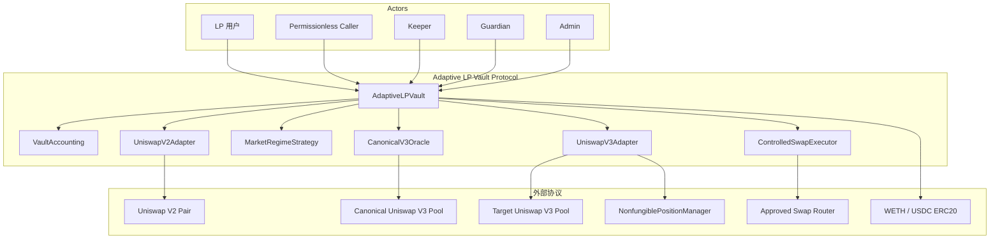
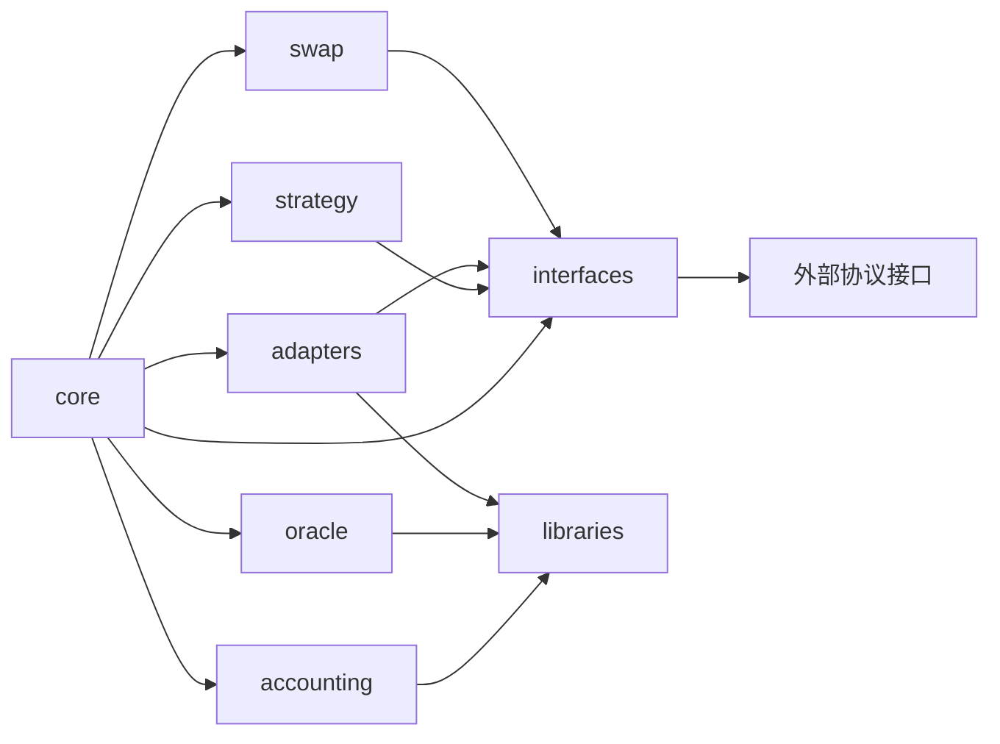
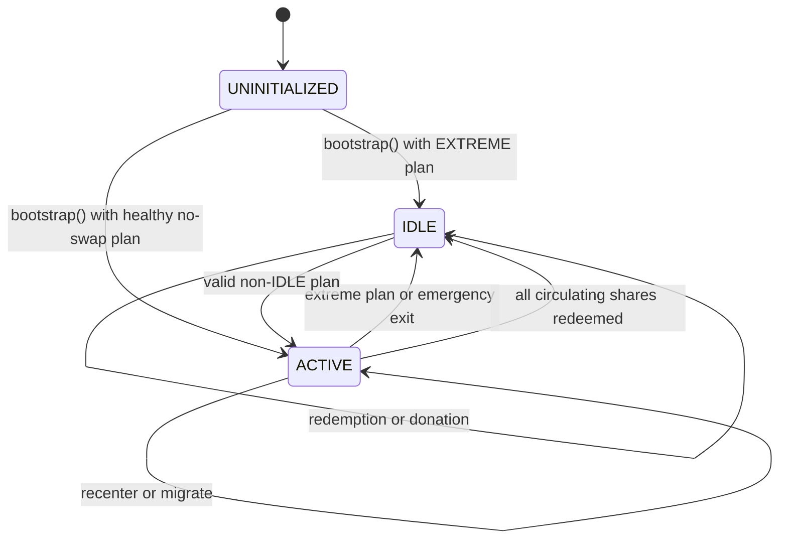
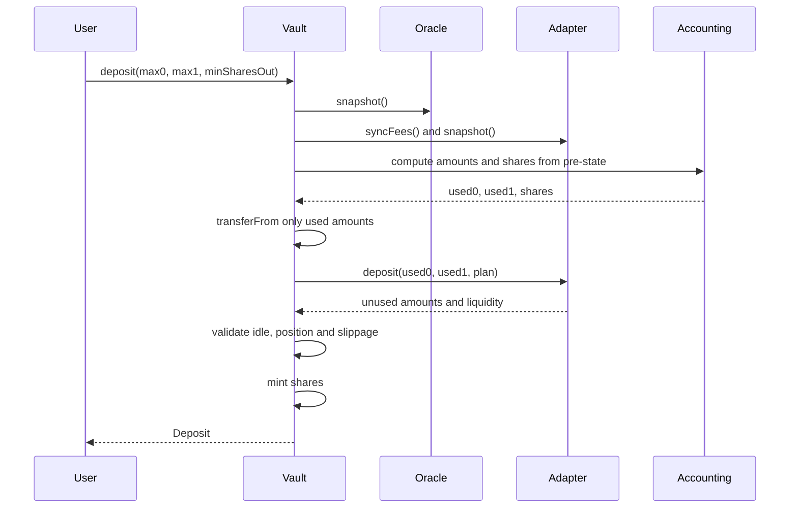

# Adaptive LP Vault 架构文档

- 文档版本：1.0
- 文档状态：实现规范
- 实现基线：Foundry + Solidity
- 对应产品文档：[PRODUCT_SPEC.md](PRODUCT_SPEC.md)
- 代码状态：本文档中的目录、接口和类型为待实现设计，不表示仓库已有合约代码

本文档定义合约边界、依赖方向、存储模型、接口、错误、事件、调用时序和测试要求。产品规则以 [PRODUCT_SPEC.md](PRODUCT_SPEC.md) 为准；两份文档中的名称必须保持一致。

## 1. 架构原则

1. `AdaptiveLPVault` 是唯一资产编排入口，负责权限、状态机、资产转移和跨模块原子性。
2. `VaultAccounting` 是无状态数学模块，不持有资产、不调用外部合约、不决定策略。
3. `CanonicalV3Oracle` 是部署时绑定的唯一价格来源；`deviationBps` 在 Oracle 内部产生，不从调用者输入。
4. `MarketRegimeStrategy` 只读链上快照并确定性生成 `PositionPlan`，不转移资产、不调用 AMM。
5. `IPositionAdapter` 隔离 Uniswap V2/V3 细节，Adapter 不能铸造或销毁 shares。
6. `ControlledSwapExecutor` 不是通用交易聚合器，只能按 Vault 验证过的 `SwapPlan` 执行 token0/token1 交换。
7. Registry 的遍历不是资产会计路径。Vault 只读取 `activeVenue` 对应 Adapter，保证 Gas 有界。
8. 所有资产迁移入口采用 Checks-Effects-Interactions、非重入保护和外部调用后的状态重读。

## 2. 系统边界



### 2.1 依赖方向

允许的依赖方向如下：



禁止以下依赖：

- Accounting 依赖 Vault 存储、Adapter 具体实现或外部调用；
- Strategy 依赖 msg.sender、Keeper 参数或任意 Router；
- Adapter 直接铸造/销毁 shares 或修改 Vault 的策略状态；
- Oracle 读取目标 Venue 作为价格来源；
- Swap Executor 修改 `activeVenue`、shares 供应量或策略参数。

## 3. Foundry 项目目录

以下目录是规划中的实现结构，当前仓库未实现这些 Solidity 文件。

```text
AdaptiveLPVault/
├── foundry.toml
├── remappings.txt
├── src/
│   ├── core/
│   │   ├── AdaptiveLPVault.sol
│   │   ├── VaultRoles.sol
│   │   └── VaultPause.sol
│   ├── accounting/
│   │   ├── VaultAccounting.sol
│   │   └── AccountingTypes.sol
│   ├── oracle/
│   │   ├── CanonicalV3Oracle.sol
│   │   └── OracleTypes.sol
│   ├── strategy/
│   │   ├── MarketRegimeStrategy.sol
│   │   └── StrategyTypes.sol
│   ├── adapters/
│   │   ├── AdapterRegistry.sol
│   │   ├── UniswapV2Adapter.sol
│   │   ├── UniswapV3Adapter.sol
│   │   └── AdapterTypes.sol
│   ├── swap/
│   │   ├── ControlledSwapExecutor.sol
│   │   └── SwapTypes.sol
│   ├── interfaces/
│   │   ├── IAdaptiveLPVault.sol
│   │   ├── IVaultAccounting.sol
│   │   ├── ICanonicalV3Oracle.sol
│   │   ├── IMarketRegimeStrategy.sol
│   │   ├── IPositionAdapter.sol
│   │   ├── IAdapterRegistry.sol
│   │   ├── IControlledSwapExecutor.sol
│   │   ├── IUniswapV2External.sol
│   │   └── IUniswapV3External.sol
│   └── libraries/
│       ├── PriceMath.sol
│       ├── PositionPlanHash.sol
│       ├── SafeTransferLib.sol
│       └── ValidationLib.sol
├── test/
│   ├── unit/
│   │   ├── VaultAccounting.t.sol
│   │   ├── CanonicalV3Oracle.t.sol
│   │   ├── MarketRegimeStrategy.t.sol
│   │   ├── UniswapV2Adapter.t.sol
│   │   ├── UniswapV3Adapter.t.sol
│   │   └── ControlledSwapExecutor.t.sol
│   ├── integration/
│   │   ├── DepositRedeem.t.sol
│   │   └── Rebalance.t.sol
│   ├── invariant/
│   │   ├── VaultInvariants.t.sol
│   │   └── AccountingInvariants.t.sol
│   ├── fork/
│   │   ├── MainnetOracle.t.sol
│   │   └── MainnetUniswapFlows.t.sol
│   ├── mocks/
│   └── helpers/
├── script/
│   ├── Deploy.s.sol
│   ├── Configure.s.sol
│   └── Bootstrap.s.sol
├── lib/
├── docs/
│   ├── PRODUCT_SPEC.md
│   └── ARCHITECTURE.md
└── README.md
```

目录职责：

| 目录 | 职责 | 约束 |
| --- | --- | --- |
| `src/core` | Vault 入口、角色、暂停和状态机 | 唯一资产编排层 |
| `src/accounting` | NAV、shares、比例、Idle 和损失计算 | 无状态、无外部调用 |
| `src/oracle` | Uniswap V3 `observe`、报价和健康检查 | 不接受外部价格输入 |
| `src/strategy` | Market Regime、Hysteresis、Range 和计划 | 只读、确定性 |
| `src/adapters` | Registry 及 V2/V3 Venue 适配 | 只能由 Vault 调用资产方法 |
| `src/swap` | 白名单 Router 和受限 Swap | 不得成为通用聚合器 |
| `src/interfaces` | 内外部协议契约 | 不包含实现状态 |
| `src/libraries` | 全精度数学、哈希和安全转账 | 不保存协议状态 |
| `test/unit` | 单模块行为 | Mock 外部依赖 |
| `test/integration` | 跨模块完整流程 | 覆盖原子回滚 |
| `test/invariant` | 不变量和模糊测试 | 覆盖资产、shares、单活 Position |
| `test/fork` | Mainnet/Fork 外部协议行为 | 验证真实 V2/V3 接口 |
| `script` | 分阶段部署、Adapter 绑定和一次性 Bootstrap | 数值参数仅由 Deploy 写入；主网按 Deploy → Configure → Bootstrap 执行，`bootstrap()` 内部执行最终绑定校验 |
| `docs` | 发布后的文档副本 | 以根目录规范为源 |

## 4. 核心类型与枚举

以下为 Solidity 类型契约的规范形状。字段名、顺序和语义不得在实现中无记录变更。

### 4.1 枚举

```solidity
enum VenueType {
    IDLE,
    UNISWAP_V2,
    UNISWAP_V3_LOW_FEE,
    UNISWAP_V3_HIGH_FEE
}

enum MarketRegime {
    LOW_DEVIATION,
    MEDIUM_DEVIATION,
    HIGH_DEVIATION,
    EXTREME_DEVIATION
}

enum PauseFlag {
    DEPOSIT,
    PLAIN_REBALANCE,
    SWAP_REBALANCE
}
```

`VenueType` 描述资产位置，`MarketRegime` 描述Strategy 市场状态，Oracle 健康性由 `OracleSnapshot.healthy` 独立表达；暂停标志是另一独立维度，三者不能合并为一个状态枚举。

### 4.2 部署配置类型

```solidity
struct VaultConfig {
    address token0;
    address token1;
    uint8 token0Decimals;
    uint8 token1Decimals;
    uint256 dustTolerance0;
    uint256 dustTolerance1;
    address canonicalOracle;
    address swapExecutor;
    uint256 minimumLockedShares;
    uint256 minimumInitialNav;
    uint16 bootstrapRatioToleranceBps;
}

struct OracleConfig {
    uint32 twapWindowSeconds;
    uint32 shortTwapWindowSeconds;
}

struct StrategyConfig {
    uint32 minRebalanceCooldown;
    uint24 enterMediumBps;
    uint24 exitMediumBps;
    uint24 enterHighBps;
    uint24 exitHighBps;
    uint24 enterExtremeBps;
    uint24 exitExtremeBps;
    int24 narrowRangeHalfWidth;
    int24 wideRangeHalfWidth;
    uint16 minRecenterBps;
    uint16 minDeployBps;
    uint16 maxHealthyIdleBps;
    uint16 maxSwapSlippageBps;
    uint16 maxMigrationLossBps;
}
```

`VaultConfig`、`OracleConfig` 和 `StrategyConfig` 仅作为构造参数与内存传参结构，不作为整体状态变量写入普通 storage。各字段在部署时通过协议硬边界与字段关系校验后，分别写入所属合约的 Solidity `immutable` 状态变量；部署后任何角色均不得修改。

### 4.3 Oracle 与资产快照

```solidity
struct OracleSnapshot {
    int24 spotTick;
    int24 twapTick;
    int24 shortTwapTick;
    uint256 spotPriceToken1;
    uint256 twapPriceToken1;
    uint256 shortTwapPriceToken1;
    uint256 deviationBps;
    uint32 twapWindowSeconds;
    uint32 shortTwapWindowSeconds;
    uint32 observedAt;
    bool healthy;
}

struct AssetSnapshot {
    uint256 idle0;
    uint256 idle1;
    uint256 position0;
    uint256 position1;
    uint256 total0;
    uint256 total1;
    uint256 nav1;
    uint256 idleValue1;
    uint256 idleBps;
    uint256 totalShares;
}

struct PositionSnapshot {
    VenueType venue;
    address adapter;
    uint256 principal0;
    uint256 principal1;
    uint256 claimableFee0;
    uint256 claimableFee1;
    uint256 amount0;
    uint256 amount1;
    uint256 liquidity;
    uint256 positionId;
    int24 tickLower;
    int24 tickUpper;
}
```

`amount0/amount1` 必须等于 `principal + claimableFee` 的唯一会计结果。费用归集后，Adapter 必须重新读取并返回新的快照。

### 4.4 Position Plan 与 Swap Plan

```solidity
struct PositionPlan {
    bytes32 planHash;
    VenueType targetVenue;
    MarketRegime marketRegime;
    int24 tickLower;
    int24 tickUpper;
    uint64 version;
    bool requiresSwap;
}

struct SwapPlan {
    bytes32 planHash;
    bool zeroForOne;
    uint256 amountIn;
    uint256 minAmountOut;
    uint32 deadline;
}
```

`planHash` 必须覆盖所有影响执行结果且可稳定复算的字段，包括目标 Venue、Range、Regime、版本和 `requiresSwap`，不得覆盖当前 `block.timestamp`。候选计划的 `version` 固定为当前 `planVersion + 1`；`SwapPlan` 是 Vault 在执行入口内构造、仅传给 `ControlledSwapExecutor` 的交易级对象，不是调用者可自由提交的完整目标结构。`expectedPlanHash` 和 `expectedZeroForOne` 是调用者对预期计划与 Swap 方向的确认值；Vault 在退出旧 Position 后重新生成计划并计算实际方向，不匹配即表示计划或方向已陈旧并回滚。`deadline` 由调用入口独立校验；调用者不能传入任意目标字段、Router、实际方向或 calldata。

### 4.5 运行时控制状态

```solidity
struct PauseState {
    bool depositPaused;
    bool plainRebalancePaused;
    bool swapRebalancePaused;
}
```

`PauseState` 归属于 `AdaptiveLPVault` 的运行时控制状态，由 `VaultPause` 逻辑读写并以普通 storage 保存。

### 4.6 Registry 绑定类型

```solidity
struct AdapterConfig {
    VenueType venue;
    address adapter;
    address pool;
    uint24 feeTier;
    bool enabled;
}
```

`AdapterConfig` 归属于 Vault 继承的 `AdapterRegistry`，是 `_adapterByVenue` Mapping 的值类型。`venue` 必须与 Mapping Key 一致；Bootstrap 成功后身份绑定字段冻结，只有 `enabled` 可以继续修改。

## 5. 存储归属与状态转换

### 5.1 Vault 存储

`AdaptiveLPVault` 至少保存：

| 存储项 | 类型 | 存储方式 | 写入时机 | 约束 |
| --- | --- | --- | --- | --- |
| `token0/token1` | `address` | `immutable` | 构造 | 固定资产对和顺序；部署后不可修改 |
| `token0Decimals/token1Decimals` | `uint8` | `immutable` | 构造 | 与固定资产 decimals 一致；部署后不可修改 |
| `dustTolerance0/dustTolerance1` | `uint256` | `immutable` | 构造 | 仅用于整数舍入和最小单位容忍；部署后不可修改 |
| `canonicalOracle` | `address` | `immutable` | 构造 | 固定 `CanonicalV3Oracle` 合约；部署后不可替换 |
| `swapExecutor` | `address` | `immutable` | 构造 | 固定 `ControlledSwapExecutor` 合约；部署后不可替换 |
| `minimumLockedShares` | `uint256` | `immutable` | 构造 | Bootstrap 时铸造给 Vault 自身，永久锁定 |
| `minimumInitialNav` | `uint256` | `immutable` | 构造 | Bootstrap 最低 NAV；调用者不能覆盖 |
| `bootstrapRatioToleranceBps` | `uint16` | `immutable` | 构造 | Bootstrap 比例容差；调用者不能覆盖 |
| `minRebalanceCooldown` | `uint32` | `immutable` | 构造 | 部署时校验；部署后不可修改 |
| `enterMediumBps/exitMediumBps` | `uint24` | `immutable` | 构造 | 满足完整 Hysteresis 阈值关系；部署后不可修改 |
| `enterHighBps/exitHighBps` | `uint24` | `immutable` | 构造 | 满足完整 Hysteresis 阈值关系；部署后不可修改 |
| `enterExtremeBps/exitExtremeBps` | `uint24` | `immutable` | 构造 | 满足完整 Hysteresis 阈值关系；部署后不可修改 |
| `narrowRangeHalfWidth/wideRangeHalfWidth` | `int24` | `immutable` | 构造 | `0 < narrow < wide`；部署后不可修改 |
| `minRecenterBps/minDeployBps/maxHealthyIdleBps` | `uint16` | `immutable` | 构造 | 分别通过协议硬边界校验；部署后不可修改 |
| `maxSwapSlippageBps/maxMigrationLossBps` | `uint16` | `immutable` | 构造 | 不超过协议硬上限；部署后不可修改 |
| `initialized` | `bool` | `storage` | Bootstrap 成功 | 只能从 false 到 true |
| `activeVenue` | `VenueType` | `storage` | Bootstrap/Rebalance/Emergency Exit | 与有效 Position 一致 |
| `activeAdapter` | `address` | `storage` | Bootstrap/Rebalance | 必须来自 Bootstrap 成功后已冻结的 Registry 绑定 |
| `lastSuccessfulRebalanceAt` | `uint32` | `storage` | 成功 Position 变更 | 失败交易不更新 |
| `lastCommittedRegime` | `MarketRegime` | `storage` | Bootstrap/成功策略计划执行 | 最近一次成功执行的健康策略状态；只能是 LOW、MEDIUM、HIGH 或 EXTREME |
| `planVersion` | `uint64` | `storage` | 成功 Position 结构变化 | 初始为 0；每次成功变化递增 1，失败交易不更新 |
| `positionPlan` | `PositionPlan` | `storage` | 成功策略计划执行 | 保存最近一次成功执行的 Strategy 计划；非策略 Position 变化后可与当前资产位置不同 |
| `pauseState` | `PauseState` | `storage` | 角色操作或自动门控 | Redeem 不受影响 |

Vault 不保存由 Registry 遍历产生的冗余资产总额。`totalAssets()` 每次读取 Idle 余额和当前 Active Adapter 快照，并调用 Accounting 计算。

### 5.2 Oracle 配置存储

`CanonicalV3Oracle` 是独立部署的 Oracle 合约：

| 存储项 | 类型 | 存储方式 | 写入时机 | 约束 |
| --- | --- | --- | --- | --- |
| `twapWindowSeconds` | `uint32` | `immutable` | Oracle 构造 | 大于零且不超过协议硬上限；部署后不可修改 |
| `shortTwapWindowSeconds` | `uint32` | `immutable` | Oracle 构造 | `0 < shortTwapWindowSeconds < twapWindowSeconds`；部署后不可修改 |

Oracle 在构造时完成窗口关系和协议硬边界校验。实现可以使用两个独立的 `immutable` 字段承载，而不要求把整个 `OracleConfig` 结构体写入普通 storage。

### 5.3 Registry 存储

`AdapterRegistry` 是 `AdaptiveLPVault` 继承的内部存储与校验模块。

| 存储项 | 类型 | 存储方式 | 写入时机 | 约束 |
| --- | --- | --- | --- | --- |
| `_adapterByVenue` | `mapping(VenueType => AdapterConfig)` | 普通 `storage` Mapping | `configureAdapter`；Bootstrap 后 `setAdapterEnabled` 仅修改 `enabled` | Key 只允许三个非 IDLE Venue；不得用于遍历资产会计 |

`adapter == address(0)` 表示该 Venue 未注册。`IDLE` 不是 Adapter，`_adapterByVenue[IDLE]` 必须保持零值，`getAdapter(IDLE)` 返回 `address(0)`，`isEnterEnabled(IDLE)` 返回 `false`。`isEnterEnabled(venue)` 仅按 `adapter != address(0) && enabled` 派生 Registry 层结果；Vault 初始化、暂停、Oracle 健康和 Position 一致性由 Vault 入口另行校验。

Admin 只能在 `initialized == false` 时新增或修正 Adapter 身份绑定；`bootstrap()` 必须在任何初始资产转入、shares 铸造或 Adapter 建仓之前，在同一交易内重新校验三个非 IDLE Venue 的完整绑定，并仅在全部 Bootstrap 操作成功时通过 `initialized = true` 自动冻结身份字段。Bootstrap 失败不会冻结 Registry。`VaultBootstrapped` 作为绑定已成功冻结的链上信号。

### 5.4 Adapter 合约存储

`UniswapV2Adapter` 和 `UniswapV3Adapter` 是独立部署的 Adapter 合约；每个 Adapter 至少保存以下不可变绑定字段：

| 存储项 | 类型 | 存储方式 | 写入时机 | 约束 |
| --- | --- | --- | --- | --- |
| `vault` | `address` | `immutable` | Adapter 构造 | 只有该 Vault 可以调用资产变更方法；部署后不可替换 |
| `venue` | `VenueType` | `immutable` | Adapter 构造 | 必须与 Adapter 实现及 Registry 注册 Venue 一致 |
| `pool` | `address` | `immutable` | Adapter 构造 | 固定绑定的 V2 Pair 或 V3 Pool；部署后不可替换 |
| `token0/token1` | `address` | `immutable` | Adapter 构造 | 必须与 Vault 固定资产及顺序一致；部署后不可替换 |
| `feeTier` | `uint24` | `immutable` | Adapter 构造 | V3 必须与 Pool Fee Tier 一致；V2 固定为零 |

V3 Adapter 还保存：

| 存储项 | 类型 | 存储方式 | 写入时机 | 约束 |
| --- | --- | --- | --- | --- |
| `positionManager` | `address` | `immutable` | Adapter 构造 | 固定的 NonfungiblePositionManager；部署后不可替换 |
| `positionId` | `uint256` | `storage` | 创建 Position 或完整退出 | 无有效 NFT Position 时为零；同一 Adapter 最多一个有效 Position |

### 5.6 ControlledSwapExecutor 合约存储

`ControlledSwapExecutor` 是独立部署的 Swap 执行合约；其固定依赖和调用权限不属于 Vault 或 Registry 的存储。Executor 至少保存以下部署时固定的绑定字段：

| 存储项 | 类型 | 存储方式 | 写入时机 | 约束 |
| --- | --- | --- | --- | --- |
| `vault` | `address` | `immutable` | Executor 构造 | 只有该 Vault 可以调用 `executeSwap()`；部署后不可替换 |
| `router` | `address` | `immutable` | Executor 构造 | 固定白名单 Router；部署后不可替换 |
| `token0/token1` | `address` | `immutable` | Executor 构造 | 只能交换 Vault 固定的资产对；部署后不可替换 |
| `swapPool` | `address` | `immutable` | Executor 构造 | 固定批准使用的 Swap Pool；部署后不可替换 |
| `feeTier` | `uint24` | `immutable` | Executor 构造 | 必须与 `swapPool` 的 Fee Tier 一致；部署后不可替换 |
| `swapMethod` | 固定代码逻辑或 `immutable` 枚举 | 部署时固定 | Executor 构造 | 仅允许 v1 规定的 exact-input、single-hop 方法 |

Swap 输出接收方固定为 `vault`。Router allowance 只在执行期间按需设置并在完成后清零，不作为持久化配置。Executor 执行后根据固定 Token 的实际余额增量返回 `amountOut`，不能只依赖 Router 返回值。

### 5.7 状态转换约束



暂停开关、Oracle 健康状态、资产位置和 `lastCommittedRegime` 独立存储。任何状态转换必须在同一交易内完成相应资产和 Position 校验。

## 6. 接口契约

### 6.1 Vault 接口

```solidity
interface IAdaptiveLPVault {
    function bootstrap(uint256 amount0, uint256 amount1, address receiver) external;

    function deposit(
        uint256 amount0Max,
        uint256 amount1Max,
        uint256 minSharesOut,
        address receiver
    ) external returns (uint256 amount0Used, uint256 amount1Used, uint256 sharesMinted);

    function redeem(
        uint256 shares,
        uint256 minAmount0Out,
        uint256 minAmount1Out,
        address receiver
    ) external returns (uint256 amount0Out, uint256 amount1Out);

    function rebalance(bytes32 expectedPlanHash, uint32 deadline) external;

    function rebalanceWithSwap(
        bytes32 expectedPlanHash,
        bool expectedZeroForOne,
        uint256 amountIn,
        uint256 keeperMinAmountOut,
        uint32 deadline
    ) external;

    function emergencyExitToIdle() external;

    function previewRebalance() external view returns (PositionPlan memory);

    function totalAssets() external view returns (uint256 total0, uint256 total1);
    function assetSnapshot() external view returns (AssetSnapshot memory);
    function positionPlan() external view returns (PositionPlan memory);
    function pauseState() external view returns (PauseState memory);
}
```

入口规则：

| 函数 | 调用者 | 前置条件 | 资产流向与结果 |
| --- | --- | --- | --- |
| `bootstrap` | Admin | 未初始化、Oracle 健康、最低 NAV、配置完整 | 健康无 Swap 计划进入 ACTIVE，EXTREME 进入 IDLE，并铸造、锁定 shares；`requiresSwap` 为 true 时以 `SwapRequired()` 回滚 |
| `deposit` | 任意 LP 用户 | 健康非 IDLE、双资产比例、未暂停 | 只转入实际数量，铸造公平 shares |
| `redeem` | Shares 持有人或获授权 spender | shares 足够 | 按比例退出 Position 和 Idle，销毁 shares，返回双资产 |
| `rebalance` | 任意地址 | 健康、计划哈希、deadline、Cooldown、`requiresSwap == false` | 原子退出旧 Position、建立新 Position 或 IDLE；`requiresSwap` 为 true 时以 `SwapRequired()` 回滚 |
| `rebalanceWithSwap` | Keeper/Admin | 健康、`requiresSwap == true`、`expectedZeroForOne` 与 Vault 重算方向一致、`amountIn`/`keeperMinAmountOut`/`deadline` 有效、白名单和 NAV 限制 | Vault 内部构造受控 SwapPlan，执行换币后建立目标 Position |
| `emergencyExitToIdle` | Guardian/Admin | 可退出 Active Position | 无 Swap 清空 Position，进入 IDLE |
| `previewRebalance` | 任意地址 | 已初始化、Oracle 健康 | 返回基于当前状态的只读候选计划，不修改任何状态 |

Bootstrap 使用部署时固定的 `minimumInitialNav` 与 `bootstrapRatioToleranceBps` 完成最低 NAV 和初始比例检查；

所有写入口均应在失败时完全回滚。`redeem` 是唯一不要求 Oracle Healthy 的资产退出入口，Emergency Exit 不要求 TWAP NAV 成功但要求实际 Position 清零和资产返回。

### 6.2 Oracle 接口

```solidity
interface ICanonicalV3Oracle {
    function snapshot() external view returns (OracleSnapshot memory);
    function quoteToken0InToken1(uint256 amount0, int24 tick) external pure returns (uint256 amount1);
    function isHealthy() external view returns (bool);
    function canonicalPool() external view returns (address);
}
```

Oracle 实现约束：

- `snapshot()` 调用 canonical Pool 的 `observe([twapWindowSeconds, shortTwapWindowSeconds, 0])`；
- 分别计算 `twapTick` 和 `shortTwapTick`，负数向负无穷取整；
- 读取当前 `slot0().tick` 作为 Spot Tick，但不使用它计算 `deviationBps`；
- 使用 `TickMath`、`FullMath` 和显式 token 顺序处理报价；
- 根据 `shortTwapTick` 和 `twapTick` 的报价计算 `deviationBps`；
- 要求 `0 < shortTwapWindowSeconds < twapWindowSeconds`；
- Observation 不足、Pool 绑定不符或报价无效时返回不健康或回滚，不能返回伪造零价格；
- `quoteToken0InToken1` 不读取外部状态，不允许调用者提供替代价格。

### 6.3 Strategy 接口

```solidity
interface IMarketRegimeStrategy {
    function getPlan(
        OracleSnapshot calldata oracle,
        AssetSnapshot calldata assets,
        PositionSnapshot calldata currentPosition,
        VenueType currentVenue,
        MarketRegime lastCommittedRegime,
        StrategyConfig calldata config,
        uint64 currentVersion
    ) external view returns (PositionPlan memory);
}
```

Strategy 规则：

- Strategy 是纯读取函数，且只生成四种健康 `MarketRegime` 的可执行候选计划。
- Vault 在执行前重新取得 Oracle、资产和 Position 快照，并传入持久化的 `lastCommittedRegime` 与当前 `planVersion`；不得直接执行用户提交的旧结构体。
- 当 `oracle.healthy == false` 时，Vault 以 `OracleUnhealthy()` 回滚且不得调用 Strategy。Strategy 若收到不健康快照，也必须防御性回滚，不得返回 `PositionPlan` 或计算 `planHash`。
- 当 `currentVersion == 0` 时，不存在历史计划。Strategy 忽略 `lastCommittedRegime` 的默认枚举值，按 LOW → MEDIUM → HIGH → EXTREME 的完整进入阈值直接确定首次 Regime。
- 当 `currentVersion > 0` 时，Strategy 以 `lastCommittedRegime` 为 Hysteresis 当前状态。
- 返回计划的 `version` 等于 `currentVersion + 1`。
- LOW、MEDIUM 或 HIGH 的候选仓位若无 Swap 部署率低于 `minDeployBps`，计划必须标记 `requiresSwap`；EXTREME 以 IDLE 为目标则不要求 Swap。
- `requiresSwap == true` 时，Bootstrap 必须以 `SwapRequired()` 回滚并由 Admin 调整初始比例后重试；已初始化 Vault 的普通 `rebalance` 也必须回滚，只有 Keeper/Admin 可以改用 `rebalanceWithSwap`。
- V3 `targetCenterTick` 由 `twapTick` 对齐到距离最近的目标 Pool `tickSpacing` 整数倍得到，等距时固定向下选择。
- 同 Venue Recenter 只允许在以下任一条件满足时生成：
  - 当前 Range 宽度与 Market Regime 要求不匹配；
  - Spot 已越界，且目标中心相对当前中心至少移动当前 Range 半宽的 `minRecenterBps`。

### 6.4 Adapter 接口

```solidity
interface IPositionAdapter {
    function vault() external view returns (address);
    function venue() external view returns (VenueType);
    function snapshot() external view returns (PositionSnapshot memory);
    function syncFees() external returns (uint256 fee0, uint256 fee1);
    function previewDeposit(uint256 amount0, uint256 amount1, PositionPlan calldata plan)
        external
        view
        returns (uint256 used0, uint256 used1);
    function deposit(uint256 amount0, uint256 amount1, PositionPlan calldata plan)
        external
        returns (uint256 used0, uint256 used1, uint256 liquidity);
    function withdraw(uint256 shares, uint256 totalShares)
        external
        returns (uint256 amount0, uint256 amount1);
    function withdrawAll() external returns (uint256 amount0, uint256 amount1);
}
```

Adapter 规则：

- 所有资产变更方法只接受 Vault 调用；
- `previewDeposit()` 必须只读，并与真实 `deposit()` 使用相同的 V2 储备比例或 V3 liquidity 数学；Strategy、Swap Rebalance 预览和最终建仓不得各自实现不一致的比例算法；
- `snapshot()` 必须报告完整 principal + claimable fee，且不重复计价；
- V3 `syncFees()` 必须结晶并领取全部可领取费用到 Vault，领取后重新读取的 `snapshot()` 中 `claimableFee0/1` 必须为零；V2 `syncFees()` 为 no-op；
- `withdraw` 按 Vault 传入的 shares 比例执行，不能自行改变赎回比例；`withdraw`/`withdrawAll` 不接收用户最小输出参数，Vault 必须将按比例退出的 Position 资产与对应 Idle 资产合并后，再使用 `redeem` 的 `minAmount0Out/minAmount1Out` 校验最终输出；
- 禁用 Adapter 仍允许 `withdraw`/`withdrawAll`；
- Adapter 不得向 msg.sender 或任意外部地址发送 Vault 资产，接收方由 Vault 控制。

### 6.5 Registry 接口

```solidity
interface IAdapterRegistry {
    function configureAdapter(
        VenueType venue,
        address adapter,
        address pool,
        uint24 feeTier
    ) external;

    function getAdapter(VenueType venue) external view returns (address adapter);
    function getConfig(VenueType venue) external view returns (AdapterConfig memory);
    function isEnterEnabled(VenueType venue) external view returns (bool);
    function setAdapterEnabled(VenueType venue, bool enabled) external;
}
```

`configureAdapter` 只能由 Admin 在 `initialized == false` 时调用，用于新增或修正非 IDLE Venue 的 `adapter`、`pool` 和 `feeTier` 绑定；成功配置时将 `enabled` 初始化为 `true` 并发出 `AdapterConfigured`。

### 6.6 Swap Executor 接口

```solidity
interface IControlledSwapExecutor {
    function executeSwap(SwapPlan calldata plan, uint256 protocolMinOut)
        external
        returns (uint256 amountOut);

    function router() external view returns (address);
    function vault() external view returns (address);
    function token0() external view returns (address);
    function token1() external view returns (address);
    function swapPool() external view returns (address);
    function feeTier() external view returns (uint24);
}
```

`ControlledSwapExecutor` 在部署或不可变初始化时固定 `vault`、Router、token0/token1、`swapPool`、Fee Tier、exact-input 方法和接收地址规则，Bootstrap 后不能由 Keeper/Admin 替换。执行器只接受 `vault` 调用，并验证计划哈希、Token 对、方向、实际可用余额、`minAmountOut >= protocolMinOut`、deadline、固定接收地址和精确授权；执行完成后按实际余额增量返回 `amountOut`，不得把 Router 返回值作为唯一结果。

Executor 只承担局部 Swap 安全，不调用 Strategy、不退出或建立 Position，也不校验完整迁移损失。Vault 在 Swap 和目标建仓后重新读取两种资产与 Position，并验证部署率、Idle、NAV 损失和单活 Position；无 Swap 路径额外执行 `dustTolerance0/1` 范围内的逐 Token 资产守恒，带 Swap 路径不要求 token0/token1 分别守恒，只依赖 Executor 的实际余额增量和 `minAmountOut` 校验。完整公式见 [SWAP_REBALANE_MATH.md](SWAP_REBALANE_MATH.md)。

## 7. 错误契约

错误使用 custom error，错误名和触发语义固定如下：

```solidity
error AlreadyInitialized();
error NotInitialized();
error Unauthorized();
error Paused(PauseFlag flag);
error OracleUnhealthy();
error ObservationInsufficient();
error InvalidAssetPair();
error InvalidBootstrapRatio();
error MinimumNavNotMet();
error ZeroAmount();
error InvalidDepositRatio();
error SharesSlippage(uint256 actual, uint256 minimum);
error AssetSlippage(uint256 amount0, uint256 amount1);
error InvalidPlanHash();
error InvalidSwapDirection();
error DeadlineExpired();
error NoStateChangeRequired();
error CooldownActive(uint256 availableAt);
error SwapRequired();
error SwapNotAllowed();
error RouterNotAllowed();
error TokenNotAllowed();
error SwapAmountExceeded();
error SwapSlippage();
error MigrationLossExceeded();
error IdleLimitExceeded();
error DeploymentRatioTooLow();
error ActivePositionExists();
error PositionNotCleared();
error AdapterNotRegistered();
error AdapterDisabled();
error NotVaultCaller();
error UnsupportedToken();
error Reentrancy();
```

错误参数只能包含帮助调用者修正请求所需的信息，不得泄露可被用来绕过权限或安全限制的内部假设。`NotInitialized()` 用于要求已初始化状态的入口，包括未初始化 Vault 上的 `previewRebalance()`；该检查必须早于 Oracle 读取和 Strategy 调用。`OracleUnhealthy()` 用于 Bootstrap、Deposit、Preview 和两类 Rebalance 的健康门控，也用于 Strategy 对不健康快照的防御性回滚；该错误路径不生成或返回 `PositionPlan`。`SwapRequired()` 是回滚返回的 custom error，不是事件；当 Bootstrap 或普通 `rebalance` 遇到 `requiresSwap == true` 时使用该错误终止交易。

## 8. 事件契约

事件字段是链下索引和审计的稳定接口。所有事件由 Vault 或对应模块在状态成功更新后发出。

```solidity
event VaultBootstrapped(
    address indexed admin,
    uint256 amount0,
    uint256 amount1,
    uint256 grossInitialShares,
    uint256 lockedShares,
    VenueType initialVenue
);

event Deposit(
    address indexed caller,
    address indexed receiver,
    uint256 amount0,
    uint256 amount1,
    uint256 shares
);

event Redeem(
    address indexed caller,
    address indexed receiver,
    uint256 shares,
    uint256 amount0,
    uint256 amount1
);

event PlanGenerated(
    bytes32 indexed planHash,
    uint64 indexed version,
    VenueType targetVenue,
    MarketRegime regime,
    bool requiresSwap
);

event RebalanceExecuted(
    address indexed caller,
    bytes32 indexed planHash,
    VenueType previousVenue,
    VenueType targetVenue,
    bool withSwap,
    uint256 total0,
    uint256 total1,
    uint256 nav1,
    uint256 idleBps
);

event V3RangeChanged(
    bytes32 indexed planHash,
    int24 oldTickLower,
    int24 oldTickUpper,
    int24 newTickLower,
    int24 newTickUpper
);

event FeesSynchronized(
    address indexed adapter,
    uint256 fee0,
    uint256 fee1,
    uint256 total0,
    uint256 total1
);

event SwapExecuted(
    address indexed router,
    bool zeroForOne,
    uint256 amountIn,
    uint256 amountOut,
    uint256 protocolMinOut
);

event IdleStateChanged(
    VenueType indexed previousVenue,
    VenueType indexed currentVenue,
    uint256 idle0,
    uint256 idle1,
    uint256 idleBps
);

event AdapterConfigured(
    VenueType indexed venue,
    address indexed adapter,
    address indexed pool,
    uint24 feeTier
);
event AdapterStatusChanged(VenueType indexed venue, address indexed adapter, bool enabled);
event PauseStateChanged(bool depositPaused, bool plainRebalancePaused, bool swapRebalancePaused);
event RoleGranted(bytes32 indexed role, address indexed account, address indexed sender);
event RoleRevoked(bytes32 indexed role, address indexed account, address indexed sender);
event EmergencyExit(address indexed caller, VenueType previousVenue, uint256 amount0, uint256 amount1);
```

事件规则：

- `FeesSynchronized` 的金额是本次从 claimable 状态归集的增量，不是再次计入总资产的额外资产；
- `RebalanceExecuted` 只在所有 post-condition 成功后发出；
- 任何以 custom error 回滚的交易都不会保留事件日志，协议不定义失败事件；`SwapRequired()` 通过 revert data 返回；
- `IdleStateChanged` 只反映资产位置变化，不用于表示暂停；
- 角色变更和运行时控制状态变化不能静默跳过对应事件；
- Emergency Exit 不发 Swap 事件，因为该路径禁止 Swap。

## 9. 关键调用时序

### 9.1 Bootstrap

```mermaid
sequenceDiagram
    participant Admin
    participant Vault
    participant Oracle
    participant Accounting
    participant Strategy
    participant Adapter

    Admin->>Vault: bootstrap(amount0, amount1, receiver)
    Vault->>Vault: validate complete inherited Adapter bindings
    Vault->>Oracle: snapshot()
    Oracle-->>Vault: healthy OracleSnapshot
    Vault->>Accounting: compute seed NAV and grossInitialShares
    Vault->>Strategy: getPlan(seed snapshots, lastCommittedRegime, planVersion = 0)
    Strategy-->>Vault: deterministic initial PositionPlan with version = 1
    Vault->>Vault: validate ratio; revert SwapRequired if requiresSwap
    Vault->>Vault: transferFrom token0/token1
    Vault->>Vault: mint and lock grossInitialShares
    Vault->>Adapter: deposit if targetVenue is non-IDLE
    Adapter-->>Vault: used amounts and liquidity
    Vault->>Vault: validate ACTIVE or EXTREME IDLE post-state; commit positionPlan, lastCommittedRegime and planVersion = 1; set initialized = true and freeze bindings
    Vault-->>Admin: VaultBootstrapped
```

### 9.2 Deposit



### 9.3 Redeem

```mermaid
sequenceDiagram
    sequenceDiagram
    participant User
    participant Vault
    participant Adapter
    participant Accounting

    User->>Vault: redeem(shares, min0, min1)
    Vault->>Adapter: syncFees() and snapshot()
    Vault->>Accounting: compute fraction from pre-burn supply
    Accounting-->>Vault: proportional amounts
    Vault->>Adapter: withdraw(shares, totalShares)
    Adapter-->>Vault: token0/token1
    Vault->>Vault: add proportional Idle and validate final outputs against minAmount0Out/minAmount1Out
    Vault->>Vault: burn shares and transfer assets
    Vault->>Vault: if all circulating shares are redeemed, enter IDLE and increment planVersion without changing lastCommittedRegime
    Vault-->>User: Redeem
```

### 9.4 Plain Rebalance

```mermaid
sequenceDiagram
    participant Caller
    participant Vault
    participant Oracle
    participant Strategy
    participant OldAdapter
    participant NewAdapter

    Caller->>Vault: rebalance(expectedPlanHash, deadline)
    Vault->>Oracle: snapshot()
    Vault->>Strategy: getPlan(current snapshots, lastCommittedRegime, planVersion)
    Strategy-->>Vault: deterministic PositionPlan
    Vault->>Vault: validate deadline, hash and cooldown; revert SwapRequired if requiresSwap
    Vault->>OldAdapter: syncFees() and withdrawAll()
    OldAdapter-->>Vault: token0/token1
    Vault->>NewAdapter: deposit() without swap
    NewAdapter-->>Vault: unused amounts and liquidity
    Vault->>Vault: validate conservation, idle and single position
    Vault->>Vault: commit positionPlan, lastCommittedRegime and incremented planVersion
    Vault-->>Caller: RebalanceExecuted
```

### 9.5 Swap Rebalance

```mermaid
sequenceDiagram
    participant Keeper
    participant Vault
    participant Oracle
    participant Strategy
    participant OldAdapter
    participant SwapExecutor
    participant NewAdapter

    Keeper->>Vault: rebalanceWithSwap(expectedPlanHash, expectedZeroForOne, amountIn, keeperMinAmountOut, deadline)
    Vault->>Oracle: snapshot()
    Vault->>Strategy: getPlan(current snapshots, lastCommittedRegime, planVersion)
    Strategy-->>Vault: PositionPlan requiresSwap
    Vault->>Vault: validate hash, deadline and requiresSwap == true
    Vault->>OldAdapter: syncFees() and withdrawAll()
    OldAdapter-->>Vault: token0/token1
    Vault->>NewAdapter: previewDeposit(actual balances, current plan)
    NewAdapter-->>Vault: used0/used1
    Vault->>Vault: validate expectedZeroForOne against derived direction and amountIn; compute protocolMinOut and SwapPlan
    Vault->>SwapExecutor: executeSwap(validated SwapPlan, protocolMinOut)
    SwapExecutor-->>Vault: actual amountOut
    Vault->>NewAdapter: deposit() with adjusted assets
    NewAdapter-->>Vault: unused amounts and liquidity
    Vault->>Vault: validate NAV loss, deployment, idle, dust tolerance and position
    Vault->>Vault: commit positionPlan, lastCommittedRegime and incremented planVersion
    Vault-->>Keeper: RebalanceExecuted and SwapExecuted
```

### 9.6 Emergency Exit

```mermaid
sequenceDiagram
    participant Guardian
    participant Vault
    participant Adapter

    Guardian->>Vault: emergencyExitToIdle()
    Vault->>Adapter: syncFees()
    Vault->>Adapter: withdrawAll()
    Adapter-->>Vault: token0/token1
    Vault->>Vault: verify position liquidity == 0
    Vault->>Vault: activeVenue = IDLE; increment planVersion; without changing lastCommittedRegime; pause deposits and rebalances
    Vault-->>Guardian: EmergencyExit
```

## 10. 关键实现细节

### 10.1 V3 Oracle 数学

- `observe([twapWindowSeconds, shortTwapWindowSeconds, 0])` 返回三个累计 Tick；分别计算 `twapTick` 和 `shortTwapTick`。
- 负的非整除结果必须向负无穷取整，而不是 Solidity 默认的向零截断。
- 用 `TickMath.getSqrtRatioAtTick` 计算报价，使用 `FullMath.mulDiv` 防止中间乘法溢出。
- `Q1(amount0; tick)` 必须明确 raw units 和 token decimals；不得把人类可读小数直接送入 raw-unit 数学。
- Oracle 使用 `shortTwapTick` 和 `twapTick` 计算 `deviationBps`；NAV 仍使用 `twapTick`，`spotTick` 保留用于 Range 越界和 Swap 风控。

### 10.2 V3 费用读取顺序

推荐实现顺序：

1. 读取 Position Manager 的 `positions(tokenId)`，取得 liquidity、Tick 边界、fee growth 快照和 tokens owed。
2. 通过 Pool 的 Position 状态计算尚未写入 Manager 缓存的 fee growth 增量；只读路径不得依赖状态修改。
3. 只读估值将 principal 与 claimable fee 合并一次形成 `PositionSnapshot.amount0/amount1`。
4. Deposit、Redeem、Rebalance 或 Emergency Exit 前，V3 `syncFees()` 必须通过零 liquidity poke 等方式结晶费用，并领取全部可领取费用到 Vault。
5. 收取后重新读取 `positions(tokenId)`、Vault ERC-20 余额和 Adapter 快照；用于后续状态变更的快照中 `claimableFee0/1` 必须为零。
6. 旧快照不得继续参与 post-state 会计。

若底层 Position Manager 的具体版本不支持某个读取路径，必须在 Adapter 内实现等价的唯一计价路径，并在测试中证明同一费用不会被两次计入。

### 10.3 V2 资产读取

V2 Adapter 读取 Pair `getReserves()`、LP Token 总供应量和 Adapter 持有的 LP Token 余额。按比例计算的储备权益同时包含交易费用形成的储备增长，不再产生独立 claimable fee 字段。

### 10.4 舍入与全精度

Bootstrap 使用 `grossInitialShares = mulDiv(NAV_seed, 10^18, 10^token1Decimals)`，向下舍入；`minimumLockedShares` 包含在该总量内并铸造给 Vault 自身（`address(this)`），其余铸造给 `receiver`。Vault 不提供锁定 shares 的转出或救援机制。

| 操作 | 舍入方向 | 原因 |
| --- | --- | --- |
| 存款实际数量 | 向下 | 不超过用户最大输入 |
| shares 铸造 | 向下 | 不让新用户取得超额权益 |
| 赎回 token 输出 | 向下 | `dustTolerance0/1` 范围内的余额留在 Vault，保护剩余持有人 |
| `idleBps` | 向下 | 不因显示舍入误判健康 |
| 迁移损失下限 | 向下计算允许损失 | 不放宽安全阈值 |
| V3 mean tick | 向负无穷 | 与 Uniswap V3 OracleLibrary 语义一致 |

### 10.5 授权与回调

- Adapter 对 Position Manager、Pair、Router 的授权使用最小额度，并在不需要时清零。
- Swap Executor 的 Router 回调接收方固定为 Swap Executor 或 Vault，不接受外部 receiver。
- 每个外部调用前后检查 `address(this)` 余额变化、Position 状态和目标 Token。
- 所有入口使用 `nonReentrant`；Token 回调、V3 mint callback 和 Router callback 必须验证发送方。

## 11. 安全不变量与测试矩阵

### 11.1 必须保持的不变量

| 编号 | 不变量 | 违反时 |
| --- | --- | --- |
| INV-01 | 支持资产所有权始终属于 shares 持有人 | 回滚或暂停相关入口 |
| INV-02 | 非 IDLE 时最多一个有效 Active Position | Rebalance 回滚 |
| INV-03 | IDLE 时所有 Adapter 有效 liquidity 为零 | Emergency/状态更新回滚 |
| INV-04 | `totalAssets` 不重复计入 principal、fees 或 Donation | 会计测试失败 |
| INV-05 | Deposit shares 使用存款前 NAV/Supply | Deposit 回滚 |
| INV-06 | Redeem 使用销毁前 Supply 并按比例退出 Idle/Position | Redeem 回滚 |
| INV-07 | Oracle 不健康时不执行价值相关操作 | 入口回滚 |
| INV-08 | Permissionless Caller 不能改变计划内容 | 计划哈希校验失败 |
| INV-09 | Swap 只允许固定 token0/token1、部署时封存的 Router/方法和目标过量资产修复范围 | Swap 回滚 |
| INV-10 | 失败交易不更新 Cooldown、版本或资产位置 | 原子回滚 |
| INV-11 | 支持资产 Donation 不可被角色救援 | 不存在对应接口 |
| INV-12 | Pause 不阻止正常双资产 Redeem | 赎回测试失败 |
| INV-13 | `lastCommittedRegime` 只由成功执行的健康 Strategy 计划更新，不从 `activeVenue` 推导 | 状态机测试失败 |
| INV-14 | 每次成功的 Position 结构变化使 `planVersion` 恰好递增 1，失败交易及非结构变化不更新 | 版本与原子性测试失败 |

### 11.2 测试矩阵

| 测试层 | 必测场景 |
| --- | --- |
| Accounting 单元测试 | raw units、decimals、负 Tick、NAV、Bootstrap/Deposit shares 舍入、Idle、迁移损失、零值和溢出边界 |
| Oracle 单元测试 | 长/短窗口 `observe` 累计 Tick、负数向负无穷取整、观察不足、Pool 绑定、报价方向、Short TWAP/TWAP 偏离 |
| Strategy 单元测试 | Oracle 不健康快照回滚且不生成计划、`planVersion == 0` 的首次完整分类、四种历史 regime 的进入/退出 Hysteresis、`lastCommittedRegime` 传递、候选版本、Range 对齐、越界与中心偏移 Recenter、部署率和稳定计划哈希 |
| V2 Adapter 测试 | 储备权益、费用已包含、部分退出、最小输出、Token 顺序 |
| V3 Adapter 测试 | principal、tokens owed、fee growth 增量、领取后重读、Range、部分退出、旧 NFT 清理 |
| Swap 测试 | 固定 Router/Token 方法、方向、过量资产修复范围、minOut、deadline、回调和授权清理 |
| Deposit/Redeem 集成测试 | 只转实际数量、暂停赎回、Oracle 异常赎回、捐赠、单边/高 Idle、比例公平性 |
| Rebalance 集成测试 | V2↔V3、V3↔V3、进入/退出 IDLE、未初始化 Preview 回滚 `NotInitialized()`、Oracle 不健康 Preview 回滚 `OracleUnhealthy()`、Emergency Exit 与全部流通 shares 赎回后的 Regime 保留和版本递增、`expectedPlanHash`、deadline、无 Swap 资产守恒、带 Swap 实际输出与 NAV 损失、后置条件和原子回滚 |
| Invariant/Fuzz | 资产守恒、shares 公平性、单活 Position、费用不重复、任意调用者不能越权 |
| Mainnet Fork | 真实 canonical Pool TWAP、V2 Pair、V3 Position Manager、Router 和 Tick spacing |
| 安全测试 | 重入、闪电贷 Spot 操纵、Sandwich、Adapter 恶意返回、权限和暂停滥用 |

## 12. 交付前检查

- `PRODUCT_SPEC.md` 与本文档的函数、类型、事件、角色和参数名称一致。
- 所有规划目录已明确标记为待实现结构，不能被误读为已存在代码。
- 所有 Mermaid、表格和 Solidity 代码块位于 Markdown 顶层，且围栏成对闭合。
- 所有资产变更方法定义调用者、输入、输出、失败条件和原子性。
- V3 Oracle、V3 费用同步、V2 储备计价和 Donation 语义均有可执行测试用例。
- 没有支持资产 rescue/sweep 接口，没有外部 `DEVIATION` 入参，没有将 `deviationBps` 描述为波动率。
- 所有事件在状态成功更新后发出，并包含足以重建资产位置和策略状态的字段。