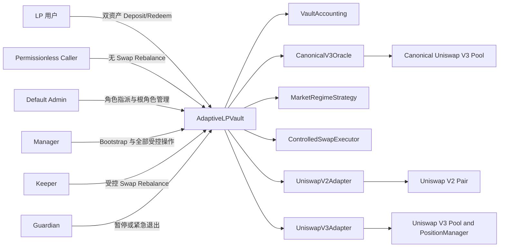

# Adaptive LP Vault 产品技术文档

- 文档版本：1.0
- 文档状态：实现规范
- 适用范围：v1 双资产、单活 Venue、纯链上策略的智能合约系统
- 示例资产：WETH / USDC
- 目标网络：Ethereum Mainnet
- 实现基线：Foundry + Solidity
- 实现状态：本文档定义待实现协议，不表示合约已部署、审计或通过测试

本文档只定义产品行为、业务规则和计算口径。合约模块、数据结构、接口、事件、测试目录和调用时序见 [ARCHITECTURE.md](ARCHITECTURE.md)。

## 1. 产品定义与边界

### 1.1 产品定义

Adaptive LP Vault 是一个针对固定 `token0/token1` 资产对的双资产流动性管理 Vault。用户按 Vault 存款前的总资产比例提供两种资产，获得可转让的 ERC-20 shares。Shares 代表对 Vault 当前全部底层资产的按比例所有权，包括 Idle 余额、Active Position 的本金和已归属手续费。

Vault 根据 canonical Uniswap V3 Pool 产生的链上价格信号，在以下 Venue 中选择一个目标状态：

- Uniswap V2 全价格区间流动性；
- Uniswap V3 低费率池的窄区间；
- Uniswap V3 高费率池的宽区间；
- IDLE，即不持有外部 LP Position。

v1 不承诺最大化 APY，也不使用链下报价、链下策略签名或外部数据服务。策略只提供可重复验证的风险状态和目标 Position Plan。

### 1.2 v1 固定边界


| 边界              | v1 规则                                             | 不属于 v1                                |
| --------------- | ------------------------------------------------- | ------------------------------------- |
| 资产              | 每个 Vault 永久绑定一对 `token0/token1`；示例为 WETH/USDC     | 动态更换资产对、Fee-on-Transfer、Rebasing 资产   |
| Shares          | Vault 自己发行 ERC-20 shares；存取款均为双资产                 | 标准单资产 ERC-4626 接口、自动换币存款              |
| Active Position | 任意时刻最多一个 Adapter 持有有效 LP Position                 | 多 Venue 并行权重、连续组合优化                   |
| 价格来源            | 部署时固定且不可替换的 canonical Uniswap V3 Pool             | Chainlink、后端价格、调用者传入价格、目标池自报价         |
| 策略输入            | Oracle 内部计算 `deviationBps`；Strategy 只读取 Oracle 快照 | 调用者传入 `DEVIATION`、历史标准差、实现波动率、手续费 APR |
| 普通 Rebalance    | 允许撤出旧仓并使用现有双边资产建仓，不执行 Swap                        | 任意 Router、任意 calldata、调用者指定目标         |
| Swap Rebalance  | 仅 Keeper/Manager 使用受限的 token0/token1 Swap           | 通用聚合器、用户自定义路径、无上限 Swap                |
| 支持 Venue        | Uniswap V2、两个指定 Fee Tier 的 Uniswap V3、IDLE        | 动态新增 DEX 或初始化后替换 Adapter              |
| 底层资产处理          | 直接转入的 token0/token1 永久计入 Vault，视为捐赠               | 对支持资产执行 rescue、sweep 或返还              |


### 1.3 明确的非目标

以下内容不会作为 v1 的产品承诺或策略输入：

- 根据历史手续费推断未来收益；
- 以 APY、手续费率或无常损失的估计值执行收益最大化；
- 通过 Swap 把用户的单边存款转换为双资产；
- 在 Oracle 不健康时继续进行价值相关的存款或 Rebalance；
- 通过管理员提款、救援或任意转账解决会计问题；
- 通过一个“波动率”字段代替明确的价格偏离定义。


## 2. 参与者与权限

权限由链上角色控制。角色权限不等于资产所有权；任何角色都不能直接取得 Vault 支持资产本金。


| 角色                    | 可调用操作                                      | 业务权限                           | 明确禁止                                                             | 暂停影响                                                                           |
| --------------------- | ------------------------------------------ | ------------------------------ | ---------------------------------------------------------------- | ------------------------------------------------------------------------------ |
| LP 用户                 | `deposit`、`redeem`、shares 转账、只读查询          | 按规则提供双资产、获得和转让 shares、按比例赎回    | 单边存款、指定策略目标、调用 Swap Rebalance、取得额外 shares                        | `depositPaused` 不影响赎回；其他暂停不应阻止正常双资产赎回                                          |
| Permissionless Caller | `rebalance`、只读查询                           | 触发当前有效且由 Strategy 生成的无 Swap 计划 | 指定 Venue、Fee Tier、Tick Range、Swap、Router 或接收地址                   | 受 `plainRebalancePaused`、Cooldown、Oracle 健康、`expectedPlanHash` 和 `deadline` 限制 |
| Keeper                | `rebalanceWithSwap`、普通 Rebalance、只读查询      | 按受控 Swap 参数修复资产比例并执行有效目标计划     | 任意 Token、任意 Router、超限数量、降低协议 `minOut`、绕过 NAV 检查                  | 受 `swapRebalancePaused` 和全部 Oracle/风控门控限制                                      |
| Guardian              | 暂停入口、禁用 Adapter、`emergencyExitToIdle`、只读查询 | 在异常情况下停止风险操作并无 Swap 撤出 LP      | 更换核心依赖、提取支持资产、执行任意 Swap                                          | 可暂停存款和 Rebalance；不应冻结赎回或紧急退出                                                   |
| Default Admin         | 业务角色授予/撤销、根管理员两阶段转移与延迟管理、只读查询 | 仅管理权限归属和根角色生命周期              | 在未另持业务角色时调用 Bootstrap、暂停、Adapter 或资产操作                           | 业务暂停不影响角色管理；不因根角色自动取得任何业务权限                                                 |
| Manager               | Bootstrap、Adapter 状态管理、全部受控操作              | 初始化 Vault、配置既有依赖、管理运行时控制状态     | 修改部署固定数值、Bootstrap 后替换 Oracle/Router/Adapter、sweep 支持资产、绕过用户输出保护 | 可管理暂停状态，但不能以暂停为由提取用户资产                                                         |


角色变更、Default Admin 转移/延迟计划、暂停状态和 Adapter operational 状态变化必须发出对应事件。全部协议业务与风控数值配置在部署时固定，运行期不存在协议参数更新入口；`defaultAdminDelay` 仅属于访问控制基类的根管理员安全机制。

## 3. 领域术语


| 术语                         | 规范定义                                                                      | 数据来源或计算方式                               | 可变性与禁止混用                                  |
| -------------------------- | ------------------------------------------------------------------------- | --------------------------------------- | ----------------------------------------- |
| Vault                      | 持有 Idle 资产、发行 shares 并编排所有模块的核心合约                                         | 合约存储和 Adapter 快照                        | Vault 不实现 V2/V3 内部数学                      |
| token0 / token1            | Vault 初始化时固定的两种底层资产及其顺序                                                   | immutable 地址和 decimals                  | 不得按调用者输入重排；所有接口使用固定顺序                     |
| Venue                      | 一个具体的流动性池实例或 IDLE 状态                                                      | `VenueType` 加 Adapter 配置                | Venue 不是抽象的 DEX 名称                        |
| Adapter                    | 封装某个 Venue 的存取流动性、费用和 Position 数据的受信模块                                    | Registry 中的固定地址                         | Adapter 不能决定 shares 数量；禁用后仍必须可退出          |
| Active Position            | 当前唯一有效的外部 LP Position                                                     | Active Adapter 的 Position 快照            | 非 IDLE 时最多一个；IDLE 时必须为零                   |
| Idle Assets                | 直接保存在 Vault、未部署到 LP 的 token0/token1                                       | Vault ERC-20 余额                         | 不是固定比例缓冲；由部署结果、费用、舍入或 IDLE 产生             |
| Principal                  | 当前 LP liquidity 对应的底层 token0/token1 数量，不含未领取手续费                           | V2 储备权益或 V3 liquidity 数学                | 不得与 claimable fee 重复相加                    |
| Claimable Fees             | 已归属于 Position 但尚未转入 Vault 的 token0/token1 手续费                             | V2 已包含在储备权益；V3 fee growth / tokens owed | 只可在一个计价路径中出现                              |
| Total Assets               | Idle 加 Active Adapter 对 Vault 的完整资产报告                                     | `T0 = I0 + A0`、`T1 = I1 + A1`           | 不得额外扫描未知 Adapter 或重复添加费用                  |
| NAV                        | 按 canonical TWAP 将全部资产折算为 token1 的价值                                      | `NAV1 = T1 + Q1(T0; twapTick)`          | 仅用于定价和风控，不代表可立即换成 token1                  |
| TWAP                       | canonical V3 Pool 在 `twapWindowSeconds` 内的 arithmetic mean tick 对应的几何平均价格 | `observe([twapWindowSeconds, 0])`       | 用于 NAV、目标 Range 和偏离基准，不是现价或统计波动率          |
| Short TWAP Tick            | canonical V3 Pool 在 `shortTwapWindowSeconds` 内的 arithmetic mean tick      | `observe([shortTwapWindowSeconds, 0])`  | 只用于偏离信号，不单独作为 NAV                         |
| Spot Tick                  | canonical Pool 当前 `slot0().tick`                                          | 同一 Oracle 读取                            | 用于 Range 越界和安全检查，不参与 `deviationBps` 或 NAV |
| DEVIATION / `deviationBps` | 短周期 TWAP 价格相对 TWAP 价格的绝对偏离，单位为基点                                          | Oracle 内部计算                             | 不接受外部输入；不得命名为 volatility                  |
| Oracle Healthy             | Oracle 地址、资产顺序、观察历史、窗口、Tick 和报价均满足可用性检查                                   | Oracle 健康检查                             | 与 `EXTREME_DEVIATION` 独立；极端偏离可以仍然健康       |
| Market Regime              | Strategy 根据健康 Oracle 快照和滞后规则输出的策略状态                                       | LOW/MEDIUM/HIGH/EXTREME                 | 不是收益评级或风险免责                               |
| Last Committed Regime / `lastCommittedRegime` | 最近一次成功执行的健康 Strategy 计划所提交的 Regime，作为 Hysteresis 历史 | Vault 持久化状态 | 不从 `activeVenue` 推导；Emergency Exit、全部流通 shares 赎回和 Oracle 不健康不覆盖 |
| Plan Version / `planVersion` | Position 结构状态的单调版本；候选计划使用下一版本 | Vault 持久化状态 | `0` 仅表示首次计划尚未成功；成功结构变化后递增 |
| Position Plan              | 目标 Venue、V3 Range、计划版本和是否需要 Swap 的完整目标                                    | Strategy 确定性生成                          | Rebalance 调用者只能提交期望哈希和 deadline，不能改写内容    |
| Hysteresis                 | 状态进入和退出使用不同阈值形成的滞后区间                                                      | Strategy 参数                             | 不能用 Cooldown 替代                           |
| Cooldown                   | 两次成功 Position 变更之间的最小时间间隔                                                 | Vault 存储的时间戳                            | 失败交易不更新                                   |
| Donation                   | 未铸造 shares 而直接转入 Vault 的支持资产                                              | ERC-20 实际余额增加                           | 永久归现有 shares 持有人；v1 不提供救援                 |


## 4. 系统行为总览

Vault 的职责是校验和编排；Accounting 负责统一计价；Oracle 负责产生价格快照；Strategy 负责生成目标；Adapter 负责与具体 AMM 交互；Swap Executor 只负责受限换币。




### 4.1 单活 Position 规则

- `activeVenue == IDLE` 时，所有 Adapter 的有效 liquidity、LP Token 余额或 NFT Position liquidity 必须为零。
- `activeVenue != IDLE` 时，只有对应 Adapter 可以有非零有效 Position；其余 Adapter 只能保留零余额或 `dustTolerance0/1` 范围内的余额。
- Rebalance 必须先完成旧 Position 退出，再建立新 Position；整个过程在一笔交易内原子完成。
- Vault 继承的 Adapter Registry 身份绑定在 Bootstrap 成功时随 `initialized = true` 自动冻结。Bootstrap 前仅 Manager 可通过 `configureAdapter(venue, adapter, pool, feeTier)` 配置；Bootstrap 后可以禁用或恢复已注册 Adapter，但不能新增或替换地址。


## 5. Vault 生命周期与存取款


### 5.1 生命周期状态


| 状态              | 进入条件                                 | 允许操作                               | 退出条件                               |
| --------------- | ------------------------------------ | ---------------------------------- | ---------------------------------- |
| `UNINITIALIZED` | 合约部署后                                | Manager Bootstrap、只读查询               | Bootstrap 成功后只能进入 `IDLE` 或有效 Venue |
| `IDLE`          | Bootstrap 生成 EXTREME 计划、运行中极端偏离或紧急退出 | 赎回、只读查询、有效无 Swap/Swap Rebalance 建仓 | Strategy 生成健康非 IDLE 计划并成功建仓        |
| `ACTIVE`        | 存在唯一有效 Active Position               | 赎回、健康存款、符合条件的 Rebalance            | 迁移、紧急退出或 Position 失效               |
| `PAUSED`        | 任一独立暂停开关打开                           | 仍可赎回；依暂停类型关闭入口                     | 对应暂停开关关闭且健康门控恢复                    |


`PAUSED` 不是资产位置。合约必须独立存储 `activeVenue`、`depositPaused`、`plainRebalancePaused` 和 `swapRebalancePaused`。

### 5.2 Bootstrap

Bootstrap 只能由 Manager 调用且只能成功一次。`minimumLockedShares` 在部署时固定，不能由 Manager 在 Bootstrap 调用中临时指定。

前置条件：

- Vault 尚未初始化；
- `bootstrap()` 必须在任何初始资产转入、shares 铸造或 Adapter 建仓前重新校验 token0/token1、canonical Oracle、Swap Executor 和所有 v1 Adapter 的完整绑定；校验失败则整笔交易回滚；
- Oracle Healthy，观察窗口有足够历史；
- 初始 token0 和 token1 均大于零；
- 初始 `NAV1` 不低于 `minimumInitialNav`；
- 初始资产比例在 `bootstrapRatioToleranceBps` 内。

执行规则：

1. 读取 TWAP，并根据 `amount0/amount1` 构造零 Position 的初始资产快照。
2. 以 `planVersion == 0` 表示无历史计划，调用 Strategy 生成初始计划；Strategy 忽略 `lastCommittedRegime` 的默认枚举值，按完整进入阈值分类，并返回 `version == 1` 的计划，然后校验目标 Venue、Range 和 `requiresSwap`。
3. 按第 6.4 节公式计算 `grossInitialShares`，转入 `amount0/amount1` 后完成铸造，其中 `minimumLockedShares` 铸造给 Vault 自身（`address(this)`），其余发送到 `receiver`；Vault 不提供锁定 shares 的转出或救援机制。
4. 调取`getPlan()`获取 PositionPlan，若计划为 `EXTREME_DEVIATION`，资产保留在 Vault 并直接进入 IDLE；若计划为 LOW、MEDIUM 或 HIGH，则必须满足 `requiresSwap == false` 和最低部署率，并在同一交易内建立目标 Position 后进入 ACTIVE。`requiresSwap == true` 时以 `SwapRequired()` 回滚，具体策略介绍参考第 9 节。
5. 验证部署率、资产守恒和 Position 唯一性后，将 `positionPlan` 写为初始计划、`lastCommittedRegime` 写为该计划的 `marketRegime`、`planVersion` 写为 `1`，再把 `initialized` 置为 `true`，并发出 `VaultBootstrapped` 事件。

Bootstrap 已包含首次策略执行，正常情况下不需要再手动调用一次 Rebalance。Bootstrap 失败必须回滚全部资产转移、shares 铸造和 Adapter 状态，且不发出 `VaultBootstrapped`。Bootstrap 后不得重新初始化，也不得通过销毁 shares 重新开启 Bootstrap。

### 5.3 Deposit

用户提交 `amount0Max`、`amount1Max`、`minSharesOut` 和 `receiver`。Vault 只转入按存款前资产比例计算的实际数量，不先转入全部最大值。

前置条件：

- `initialized == true`；
- `depositPaused == false`；
- Oracle Healthy；
- `activeVenue != IDLE` 且 Active Position 有效；
- 存款前 `T0 > 0`、`T1 > 0`；
- 存款前 `idleBps <= maxHealthyIdleBps`；
- 用户最大输入能够形成大于零的两边实际存款；
- shares 计算结果不低于 `minSharesOut`。

实际数量的目标关系是：

$$
\frac{d_0}{T_0} \approx \frac{d_1}{T_1}
$$

其中 `d0` 和 `d1` 是实际从用户转入的数量。整数实现必须向下舍入，并满足 `d0 <= amount0Max`、`d1 <= amount1Max`。比例误差只能来自最小单位舍入。

执行顺序：

1. 同步 Active Adapter 的费用并读取存款前资产快照。
2. 使用存款前 `NAV1` 和 `S` 计算 `d0`、`d1`、`sharesMinted`。
3. 从用户转入实际 `d0`、`d1`。
4. 按当前 Position Plan 尝试增加流动性；不能部署的数量保留为 Idle。
5. 验证 post-state 的 `idleBps`、单活 Position、资产守恒和 `sharesMinted >= minSharesOut`。
6. 铸造 shares 给 `receiver` 并发出 `Deposit` 事件。

任一检查失败，整笔交易回滚，用户未使用的最大输入不会离开钱包。

### 5.4 Redeem

用户提交 `shares`、`minAmount0Out`、`minAmount1Out` 和 `receiver`。赎回不执行 Swap，不以 Oracle 价值判断是否允许，并且不因三个业务暂停开关而关闭。

设销毁前总供应量为 `S`，用户销毁 `x` shares：

$$
 f = \frac{x}{S}
$$

$$
 out_0 = \left\lfloor f \times T_0 \right\rfloor, \qquad
 out_1 = \left\lfloor f \times T_1 \right\rfloor
$$

执行规则：

- 同步 Active Adapter 的费用并读取销毁前资产快照。
- 按 `x/S` 从 Active Adapter 部分退出，而不是优先消耗全部 Idle；
- 将按比例退出的 Position 资产与按同一比例分配的 Idle token0/token1 合并为最终 `amount0Out/amount1Out`；
- 在 Vault 层验证最终 `amount0Out >= minAmount0Out` 且 `amount1Out >= minAmount1Out`；
- 销毁 shares 后转账给 `receiver`。

如果除 `minimumLockedShares` 外的流通 shares 全部赎回，Vault 必须退出所有 LP Position 并进入 IDLE；该完整退出属于 Position 结构变化，必须使 `planVersion` 递增 1，但保持 `lastCommittedRegime` 不变。锁定 shares、`dustTolerance0/1` 范围内的舍入余额和捐赠余额按既定会计继续存在。该状态不能重新 Bootstrap。

### 5.5 Donation

直接转入 Vault 的 token0/token1 不会触发 shares 铸造，也不会被识别为用户 Deposit。实际余额增加自动进入 `I0/I1`，因此提高总资产和现有 shares 的 share price。

v1 规则如下：

- 支持资产 Donation 永久归属于现有 shares 持有人；
- Donation 可能改变存款比例、提高 `idleBps` 并关闭后续存款；
- Vault 不提供支持资产 `rescue`、`sweep`、退款或管理员提取接口；
- 非支持资产不属于 v1 核心流程，不得通过通用转账接口引入资产转移权限。


## 6. Shares 与资产会计


### 6.1 单位和快照

- 所有 ERC-20 数量在合约内部使用各自 token 的 raw units。
- Shares 固定使用 18 decimals；一份完整 share 的初始名义价值为一份完整 token1。
- `NAV1`、`minimumInitialNav` 和迁移损失均以 token1 raw units 表示。
- `Q1(amount0; twapTick)` 返回 token1 raw units；价格函数必须处理 token0/token1 地址顺序和 decimals。
- 百分比使用 `BPS = 10_000`。
- 所有乘除使用全精度 `mulDiv` 语义；不足一单位时按照每个公式规定的方向舍入。
- Shares 铸造和资产输出向下舍入；零 shares 或零实际存款必须回滚。


### 6.2 Total Assets

令：

- `I0/I1`：Vault 当前实际持有的 Idle token0/token1；
- `A0/A1`：唯一 Active Adapter 对 Vault 报告的完整 Position token0/token1；
- `P0/P1`：Position principal；
- `F0/F1`：尚未归集的 claimable fees。

统一资产定义为：

$$
T_0 = I_0 + A_0, \qquad T_1 = I_1 + A_1
$$

在费用尚未归集的读取阶段：

$$
A_0 = P_0 + F_0, \qquad A_1 = P_1 + F_1
$$

费用归集后，`F0/F1` 必须变为零，已归集数量进入 `I0/I1`，并重新读取 Adapter 快照。不得在归集后继续把旧 `F0/F1` 加入 `A0/A1`。

Registry 不得通过遍历所有 Adapter 汇总资产。只有 `activeVenue` 对应 Adapter 可以贡献 `A0/A1`，这保证查询 Gas 有界且避免禁用 Adapter 被重复计价。

### 6.3 TWAP NAV 与 Share Price

canonical Oracle 给出 `twapTick`，其报价函数定义为 `Q1`。Vault 的 token1 计价净资产为：

$$
NAV_1 = T_1 + Q_1(T_0; twapTick)
$$

当 `S > 0` 时，单份 share 的 token1 价值为：

$$
sharePrice_1 = \frac{NAV_1}{S}
$$

`NAV1` 用于 Deposit 定价、share price 展示、迁移损失和 Idle 健康检查；Redeem 默认返回原始双资产，不将资产强制换成 token1。

### 6.4 Shares 铸造

**Bootstrap**

设初始资产按 Bootstrap TWAP 计算的 token1 价值为：

$$
NAV_{seed} = amount_1 + Q_1(amount_0; twapTick_{bootstrap})
$$

创世总铸造量为：

$$
grossInitialShares = \left\lfloor \frac{NAV_{seed} \times 10^{shareDecimals}}{10^{token1Decimals}} \right\rfloor
$$

其中 `shareDecimals = 18`。接收者获得：

$$
receiverShares = grossInitialShares - minimumLockedShares
$$

`minimumLockedShares` 是 `grossInitialShares` 的一部分，不得额外增发。必须满足 `grossInitialShares > minimumLockedShares` 且 `receiverShares > 0`。该公式在首次建仓前计算，无论初始计划进入 ACTIVE 还是 IDLE 都保持不变。

**后续 Deposit**

存款前读取 `NAV_before` 和 `S_before`。用户实际存入价值为：

$$
D_1 = d_1 + Q_1(d_0; twapTick_{before})
$$

后续存款铸造量为：

$$
sharesMinted = \left\lfloor \frac{D_1 \times S_{before}}{NAV_{before}} \right\rfloor
$$

该公式必须在用户资产转入和新 Position 建立前计算。任何中间状态的资产增加都不能用于抬高用户获得的 shares。

### 6.5 Idle 比例

Idle 的 token1 价值和比例为：

$$
IdleValue_1 = I_1 + Q_1(I_0; twapTick)
$$

$$
idleBps = \left\lfloor \frac{IdleValue_1 \times BPS}{NAV_1} \right\rfloor
$$

当 `activeVenue == IDLE` 时，`idleBps` 应接近 `BPS`，不受 `maxHealthyIdleBps` 约束，但必须关闭公众 Deposit。非 IDLE 状态下，Deposit 和普通 Rebalance 必须满足各自的 Idle 上限。

### 6.6 资产守恒

无 Swap Rebalance 不改变 token0/token1 的经济构成。旧 Position 退出后，token0/token1 必须进入 Vault Idle 或新 Active Position；仅允许 `dustTolerance0/1` 范围内的整数舍入、最小单位和 AMM 数学差异：

$$
T_{0,after} \ge T_{0,before} - dustTolerance_0
$$

$$
T_{1,after} \ge T_{1,before} - dustTolerance_1
$$

`dustTolerance0` 和 `dustTolerance1` 是本文唯一的舍入容忍概念，分别使用 token0/token1 raw units 表示，只覆盖整数舍入、最小单位和 AMM 数学造成的可接受微小差异；该范围内的余额仍属于 Vault，不是可忽略的资产损失。公式中的 `dustTolerance_0/1` 分别对应这两个配置值。

### 6.7 迁移损失

带 Swap Rebalance 路径在经过 swap 后允许配置的最大价值损失：

$$
NAV_{after} \ge NAV_{before} \times \left(1 - \frac{maxMigrationLossBps}{BPS}\right)
$$

`maxMigrationLossBps` 只限制 Vault 资产价值损失，不从用户本金支付调用者 Gas。所有后置条件失败时交易回滚。

### 6.8 手续费同步与正确计价口径

手续费同步是资产会计的一部分，不是独立收益分配模块。

**V2 口径**

V2 Adapter 使用 LP Token 在 Pair 总供应量中的比例乘以 Pair 当前储备计算 `P0/P1`。交易手续费已反映在储备中，因此 V2 不再添加独立 `F0/F1`。

**V3 口径**

V3 Adapter 将 Position 报告拆成：

- `principalAmounts()`：当前 liquidity 在当前 Pool sqrt price 下对应的 token0/token1，不含手续费；
- `claimableFees()`：Position 已归属但尚未领取的 token0/token1，包括 Position Manager 已记录的 `tokensOwed` 和尚未写入缓存的 fee growth 增量；
- `positionAmounts()`：`principalAmounts() + claimableFees()`，只允许在一个会计入口生成。

在任何会改变 shares 总供应量或 Position 的操作前，Vault 必须调用 Adapter 的 `syncFees()`。对 V3，`syncFees()` 必须通过零 liquidity poke 等方式结晶费用，领取全部可领取 token0/token1 到 Vault，并重新读取 principal、实际余额和 Position；该状态变更快照中的 `claimableFees` 必须为零。对 V2，`syncFees()` 为无领取动作的 no-op，因为手续费已包含在储备权益中。`totalAssets()` 等只读查询不能领取费用，仍按 `principalAmounts() + claimableFees()` 计价一次。

上述强制同步适用于 Deposit、Redeem、普通 Rebalance、带 Swap Rebalance 和 Emergency Exit；普通 shares 转账不改变总供应量，无需同步。

费用同步必须满足：

- 费用归属 Vault，全额计入现有 shares；
- 不抽取协议费、管理费或调用者奖励；
- 同一笔费用在 `positionAmounts`、Vault 余额和 `claimableFees` 中最多出现一次；
- 任何收取费用的外部调用后都必须重新读取 Position 快照；
- `totalAssets()` 的输出必须与同步前后经济价值一致，允许的差异仅为协议定义的 `dustTolerance0/1` 范围内舍入差异。


### 6.8 捐赠对会计的影响

Donation 直接增加 `I0/I1`，没有对应 `sharesMinted`。因此 Donation 发生后：

- `NAV1` 和 `sharePrice1` 可能上升；
- `T0/T1` 的存款比例可能变化；
- `idleBps` 可能超过健康上限；
- 新 Deposit 应被关闭，直到恢复健康结构。

这不是首存或手续费结算漏洞，而是协议明确接受的无请求资产捐赠语义。

## 7. Venue 与 Adapter 行为


### 7.1 Uniswap V2 Adapter

V2 Adapter 必须固定绑定一个 Pair、Vault、token0 和 token1，并提供：

- 按 Pair 当前储备比例增加流动性；
- 读取 LP Token 余额和 Pair 总供应量；
- 完整退出和按比例部分退出；
- 将未使用输入退回 Vault；
- 通过最小输出和截止时间保护外部调用。

V2 Position 覆盖全价格区间，不存在 Tick Range，但仍承担 AMM 价格风险、无常损失、流动性风险和 MEV 风险。

### 7.2 Uniswap V3 Adapter

V3 Adapter 必须固定绑定一个 Pool、Fee Tier、Position Manager、token0/token1 和 Vault，并管理一个 NFT Position。Position 至少包含：

- `tokenId`；
- `tickLower`、`tickUpper`；
- `liquidity`；
- principal 和 claimable fee 的读取状态。

V3 Adapter 必须支持创建、增加、减少 liquidity、收取费用、按比例退出和旧 Position 清理。`tickLower < tickUpper`，两个 Tick 必须对齐 Pool 的 `tickSpacing`。旧 NFT 可以保留为零 liquidity 且零 owed fee 的清理状态，但不得被计为有效 Position。

当价格离开 Range 后，Position 可能变成单边资产并停止赚取区间内手续费。普通 Rebalance 不自动 Swap；LOW、MEDIUM 或 HIGH 状态下若缺少另一边资产导致部署率不足，计划必须标记 `requiresSwap = true`，普通 Rebalance 以 `SwapRequired` 回滚。只有 `EXTREME_DEVIATION` 的策略目标为 IDLE。

### 7.3 IDLE

IDLE 不是 Adapter，而是 `activeVenue == IDLE` 的资产位置状态。IDLE 状态下：

- 全部支持资产直接保存在 Vault；
- 不产生 LP 手续费；
- 不执行外部 LP Position；
- 仍承担 token 本身、ERC-20、Vault 和角色权限风险；
- 新 Deposit 关闭，双资产 Redeem 保持开放。


## 8. Oracle 与价格口径


### 8.1 Canonical Uniswap V3 Oracle

canonical Oracle 在部署时绑定一个 Uniswap V3 Pool。该 Pool 必须满足：

- `token0/token1` 与 Vault 固定资产对一致；
- Pool 地址、Factory、Fee Tier 和代码哈希通过初始化检查；
- Observation Cardinality 和历史覆盖时间足以满足 `twapWindowSeconds` 和 `shortTwapWindowSeconds`；
- `0 < shortTwapWindowSeconds < twapWindowSeconds`；
- Pool 不为零流动性或无历史的空池。

Oracle 不读取目标 Venue 作为自己的价格来源。V2、两个 V3 Venue 的 NAV 和 Strategy 输入都使用同一 canonical Pool。

### 8.2 TWAP 计算

Oracle 调用：

```solidity
uint32[] memory secondsAgos = new uint32[](3);
secondsAgos[0] = twapWindowSeconds;
secondsAgos[1] = shortTwapWindowSeconds;
secondsAgos[2] = 0;
(int56[] memory tickCumulatives, ) = pool.observe(secondsAgos);
int56 twapDelta = tickCumulatives[2] - tickCumulatives[0];
int24 twapTick = arithmeticMeanTickRoundedDown(twapDelta, twapWindowSeconds);
int56 shortTwapDelta = tickCumulatives[2] - tickCumulatives[1];
int24 shortTwapTick = arithmeticMeanTickRoundedDown(shortTwapDelta, shortTwapWindowSeconds);
```

`arithmeticMeanTickRoundedDown` 对负数向负无穷取整，语义与 Uniswap V3 `OracleLibrary.consult` 一致。`twapTick` 和 `shortTwapTick` 都是 arithmetic mean tick 对应的几何平均价格，不是价格简单算术平均。

Oracle 同时读取 `pool.slot0().tick` 作为 `spotTick`，但 `spotTick` 不参与 `deviationBps`。价格报价通过 `TickMath` 和全精度乘除完成；如 token 地址顺序与 Pool 内部顺序不同，必须反转报价方向并处理 decimals。

### 8.3 DEVIATION 定义

对一个固定的 `referenceAmount0`（通常为一个 token0 的 decimals。）分别使用 `shortTwapTick` 和 `twapTick` 报价：

$$
P_{short} = Q_1(referenceAmount_0; shortTwapTick)
$$

$$
P_{twap} = Q_1(referenceAmount_0; twapTick)
$$

$$
 deviationBps = \left\lfloor \frac{|P_{short} - P_{twap}| \times BPS}{P_{twap}} \right\rfloor
$$

`deviationBps` 完全由 Oracle 从链上 Pool 状态计算。任何外部函数都不能传入、覆盖或替换该值。该指标只表示短周期 TWAP 相对 TWAP 的价格偏离，不表示：

- 历史标准差；
- 实现波动率；
- 未来波动预测；
- 任何 Venue 的手续费 APR；
- 扣除无常损失后的最优收益。


### 8.4 Oracle Healthy 与失败门控

以下任一条件不满足时，`OracleSnapshot.healthy` 必须为 `false`：

- canonical Pool 地址或资产绑定不匹配；
- `twapWindowSeconds == 0`、`shortTwapWindowSeconds == 0` 或 `shortTwapWindowSeconds >= twapWindowSeconds`；
- Observation 历史不足或 `observe` 调用失败；
- Tick、平方根价格或报价计算溢出；
- `P_twap == 0`、报价为零或无法进行方向转换；
- Pool 代码或关键配置不符合初始化记录。

Oracle 不健康时：

- 关闭 Deposit；
- 禁止普通 Rebalance 和 `rebalanceWithSwap`；
- 允许正常双资产 Redeem；
- 允许 Guardian/Manager 执行不依赖价格估值的无 Swap Emergency Exit；
- 不把不健康状态强行归类为 LOW/MEDIUM/HIGH/EXTREME。

极端 `deviationBps` 是健康 Oracle 下的策略状态，不自动等同于 Oracle 不健康。

## 9. 策略与 Rebalance


### 9.1 Strategy 输入和输出

`MarketRegimeStrategy` 是只读、确定性的计划生成器。输入仅来自：

- 当前 Oracle Snapshot；
- 当前 `activeVenue` 和 Position Snapshot；
- Vault 资产比例、Idle 比例和暂停状态；
- 持久化的 `lastCommittedRegime` 和当前 `planVersion`；
- 部署时固定且受硬边界约束的策略参数。

输出为完整 `PositionPlan`，至少包含 `targetVenue`、`marketRegime`、V3 Tick Range、计划版本和 `requiresSwap`。计划哈希只覆盖这些会影响执行结果且可稳定复算的策略字段，不覆盖当前 `block.timestamp`。

Vault 提供 `previewRebalance()` 只读接口，且该接口只适用于已初始化 Vault。调用顺序必须为：

- 首先检查 `initialized == true`；未初始化时以 `NotInitialized()` 回滚，不读取默认 `positionPlan`、不调用 Strategy，也不返回占位计划。
- 初始化后读取 Oracle；Oracle 不健康时以 `OracleUnhealthy()` 回滚，不返回占位计划。
- 仅在以上检查通过后，使用与执行入口相同的 Oracle、资产、Position 快照和 Strategy 计算路径，返回包括 `planHash` 和 `requiresSwap` 在内的最新 `PositionPlan`。

前端通过回滚原因判断不可执行原因。该接口供前端和 Keeper 在发送交易前选择 `rebalance` 或 `rebalanceWithSwap`。预览结果只用于执行前判断；真正执行时 Vault 仍须重新读取最新状态、重新生成计划并校验哈希。

`planVersion` 初始为 0。成功的 Bootstrap、Venue 迁移、V3 Recenter、策略进入或退出 IDLE、Emergency Exit，以及全部流通 shares 赎回导致的完整 Position 退出，均属于 Position 结构变化并使版本恰好递增 1。沿既有 Position 按当前计划增加流动性的 Deposit、部分 Redeem、费用同步、Donation、暂停状态和 Adapter `enabled` 变化不递增版本。失败交易不得更新版本。

### 9.2 市场状态与目标 Venue


| Market Regime       | 进入条件                                                          | 目标 Venue | 目标行为                    |
| ------------------- | ------------------------------------------------------------- | -------- | ----------------------- |
| `LOW_DEVIATION`     | 健康 Oracle 且偏离低于进入 MEDIUM 的阈值                                  | V3 低费率池  | 以 TWAP Tick 为中心的窄 Range |
| `MEDIUM_DEVIATION`  | 从 LOW 上升跨过 `enterMediumBps`，或从 HIGH 下降跨过 `exitHighBps`        | V3 高费率池  | 以 TWAP Tick 为中心的宽 Range |
| `HIGH_DEVIATION`    | 从 MEDIUM 上升跨过 `enterHighBps`，或从 EXTREME 下降跨过 `exitExtremeBps` | V2       | 全价格区间，避免主动窄 Range 管理    |
| `EXTREME_DEVIATION` | 从 HIGH 上升跨过 `enterExtremeBps`                                 | IDLE     | 无 Swap 撤出或保持全部资产在 Vault |


### 9.3 Hysteresis 的精确定义

策略参数包括：`enterMediumBps`、`exitMediumBps`、`enterHighBps`、`exitHighBps`、`enterExtremeBps`、`exitExtremeBps`。参数必须满足：

$$
0 \le exitMediumBps < enterMediumBps \le exitHighBps < enterHighBps \le exitExtremeBps < enterExtremeBps
$$

状态转换规则：

- LOW 只有在 `deviationBps >= enterMediumBps` 时进入 MEDIUM；
- MEDIUM 只有在 `deviationBps <= exitMediumBps` 时回到 LOW，在 `deviationBps >= enterHighBps` 时进入 HIGH；
- HIGH 只有在 `deviationBps <= exitHighBps` 时回到 MEDIUM，在 `deviationBps >= enterExtremeBps` 时进入 EXTREME；
- EXTREME 只有在 `deviationBps <= exitExtremeBps` 时回到 HIGH；
- 未跨越当前状态对应边界时保持当前状态。

`planVersion == 0`时 Strategy 忽略 `lastCommittedRegime` 的 Solidity 默认值，按 LOW → MEDIUM → HIGH → EXTREME 的完整进入阈值直接分类。当 `planVersion > 0` 时，Strategy 使用 `lastCommittedRegime` 执行上述状态转换。Hysteresis 控制幅度，Cooldown 控制时间频率，两者不可互相替代。

### 9.4 Position Plan 生成规则


#### 9.4.1 部署率与 `requiresSwap`

对于任何非 IDLE 候选计划，Strategy 按目标 Adapter 在不执行 Swap 时可使用的 `used0/used1` 计算部署率：

$$
DeployableNAV_1 = used_1 + Q_1(used_0; twapTick)
$$

$$
deployBps = \left\lfloor \frac{DeployableNAV_1 \times BPS}{NAV_1} \right\rfloor
$$

Oracle Healthy 且状态为 LOW、MEDIUM 或 HIGH 时，`deployBps < minDeployBps` 必须标记 `requiresSwap = true`，不得静默改为 IDLE；达到门槛时标记 `requiresSwap = false`。`EXTREME_DEVIATION` 必须以 IDLE 为目标且 `requiresSwap = false`。Oracle 不健康时，Vault 必须在调用 Strategy 前以 `OracleUnhealthy()` 回滚；Strategy 若收到不健康快照也必须防御性回滚，不生成 `PositionPlan`，也不计算占位 `planHash`。

`requiresSwap = true` 表示当前资产比例无法通过无 Swap 路径达到最低部署率。Bootstrap 必须以 `SwapRequired()` 回滚，由 Manager 调整初始 token 比例后重试；已初始化 Vault 的普通 `rebalance` 同样以 `SwapRequired()` 回滚，随后只有 Keeper/Manager 可以改用 `rebalanceWithSwap` 执行该计划。EVM 回滚不会保留状态更新或事件日志，因此不会发出 `VaultBootstrapped`、`RebalanceExecuted` 或 `SwapExecuted`；调用方通过回滚返回的 `SwapRequired()` 识别失败原因。

#### 9.4.2 V3 Range 计算与 Recenter

Strategy 以 `twapTick` 为价格中心参考，不使用调用者传入的 Tick，也不直接跟随 Spot Tick。Strategy 将 `twapTick` 对齐到距离最近的目标 Pool `tickSpacing` 整数倍，等距时固定向下选择，得到确定性的 `targetCenterTick`。

根据当前 Market Regime 生成目标 Range：

- 低偏离使用 `narrowRangeHalfWidth`；
- 中偏离使用 `wideRangeHalfWidth`；
- `tickLower < tickUpper`；
- `tickLower`、`tickUpper` 均为 `tickSpacing` 的整数倍；
- Range 必须覆盖 TWAP Tick；
- Range 不能超出 Uniswap V3 最小/最大 Tick。

对于已经存在的同 Venue V3 Position，设 `currentRangeWidth = currentTickUpper - currentTickLower`，`currentRangeHalfWidth = currentRangeWidth / 2`，`currentCenterTick = currentTickLower + currentRangeHalfWidth`，`centerDelta = abs(targetCenterTick - currentCenterTick)`。只有满足以下任一条件时才允许 Recenter：

- 当前 Range 宽度与当前 Market Regime 要求的目标宽度不一致；
- 当前 Spot Tick 已离开现有 Range，并且 `centerDelta >= currentRangeHalfWidth * minRecenterBps / BPS`。

Spot 越界但 TWAP 目标中心尚未移动足够远时，不立即跟随 Spot 重建仓位。Tick 对齐后的新 Range 必须与旧 Range 不同，否则以 `NoStateChangeRequired` 回滚。

### 9.5 普通 Rebalance

任何地址可以调用 `rebalance(expectedPlanHash, deadline)`，两个保护参数均为必填。`expectedPlanHash` 表示调用者预期执行的 Strategy 计划身份，用于乐观并发控制：若交易等待期间 Oracle、Position、计划版本或策略结果发生变化，Vault 复算出的计划哈希将不匹配并回滚，避免执行调用者未确认的陈旧计划；它不允许调用者指定 Venue、Range 或 `requiresSwap`。Vault 必须先检查 `block.timestamp <= deadline`，再在交易内重新读取 Oracle、资产和 Position，并重新生成当前计划；复算哈希必须严格等于 `expectedPlanHash`。

前置条件：

- `plainRebalancePaused == false`；
- Oracle Healthy；
- `deadline` 尚未到期；
- `minRebalanceCooldown` 已结束；
- 当前状态确实需要 Venue 迁移、V3 Recenter 或进入 IDLE；
- 重新生成的 Position Plan 哈希匹配；
- `requiresSwap == false`；
- Adapter、Pool、Token 顺序和最小输出检查通过。

执行必须原子完成：同步费用、退出旧 Position、建立目标 Position 或进入 IDLE、归还未使用资产、验证资产守恒/Idle/单活 Position，然后提交 `positionPlan`，将 `lastCommittedRegime` 更新为执行计划的 `marketRegime`，并将 `planVersion` 更新为该计划的 `version`，同时更新 `lastSuccessfulRebalanceAt`。失败交易不能更新这些状态。

### 9.6 带 Swap Rebalance

`rebalanceWithSwap` 仅对 Keeper/Manager 开放，且必须使用 Strategy 重新生成的当前计划并满足 `requiresSwap == true`；若为 false 则以 `SwapNotAllowed()` 回滚。`PositionPlan` 只表达目标 Venue、Range、Regime 和执行前必须调整资产比例的事实，不包含任意 Router、路径或 calldata。

Keeper/Manager 提交 `expectedPlanHash`、`expectedZeroForOne`、 `amountIn`、`keeperMinAmountOut` 和 `deadline`。`expectedZeroForOne` 表示期望的swap方向；Vault 重新读取 Oracle、资产和 Position，校验当前计划哈希后退出旧 Position，再基于实际收回的 token0/token1、目标 Adapter 的 `previewDeposit` 和 `amountIn` 给出 `swapPlan` 并在建仓后进行各项检查。Keeper 提初始值，Vault 负责拒绝方向错误、数量不足、换过头或最终不可建仓的执行。

Router、Token 对、Pool/Fee Tier、固定 exact-input Swap 方法和接收地址规则在 `ControlledSwapExecutor` 部署或不可变初始化时配置，并在 Bootstrap 时校验；Keeper/Manager 不能在调用中替换。Vault 按 canonical TWAP 和 `maxSwapSlippageBps` 计算 `protocolMinOut`，实际最低输出取 `max(protocolMinOut, keeperMinAmountOut)`。

带 Swap 路径必须同时满足：

- `swapRebalancePaused == false`；
- Oracle Healthy；
- `currentPlan.requiresSwap == true` 且重新生成的哈希等于 `expectedPlanHash`；
- Vault 重新计算的 `zeroForOne` 等于 `expectedZeroForOne`；
- `deadline` 未过期；
- 输入 Token 是目标 Position 的明显过量资产，`amountIn` 不超过该 Token 的实际可用余额且不会把比例换过头；
- 实际输出不低于 `max(protocolMinOut, keeperMinAmountOut)`；
- Swap 后部署率和 Idle 限制满足；
- 带 Swap 路径的 Executor 实际余额增量满足 `minAmountOut`；
- 完整迁移后的 NAV 损失不超过 `maxMigrationLossBps`；
- 单活 Position 检查通过。

`ControlledSwapExecutor` 只执行并验证局部 Swap；迁移损失、部署率、Idle 和 Position 后置条件由 Vault 在建仓后统一校验。全部后置条件成功后，Vault 按普通 Rebalance 的同一规则提交 `positionPlan`、`lastCommittedRegime` 和递增后的 `planVersion`。任一条件失败时，退出旧 Position、Swap、建立新 Position 和状态更新必须全部回滚。

Swap 方向、`previewDeposit`、 `amountIn`、`protocolMinOut`、`keeperMinAmountOut`、V2/V3 比例以及舍入公式的完整定义见 [SWAP_REBALANE_MATH.md](SWAP_REBALANE_MATH.md)。

### 9.7 Emergency Exit to IDLE

Guardian/Manager 可在不依赖价格估值的情况下触发紧急退出：

1. 进入紧急操作锁；
2. 调用 `syncFees()` 结晶并领取全部可领取手续费；
3. 从 Active Adapter 移除全部 LP liquidity；
4. 不执行任何 Swap；
5. 验证支持资产回到 Vault，旧 Position liquidity 为零；
6. 设置 `activeVenue = IDLE`，使 `planVersion` 递增 1，保持 `lastCommittedRegime` 不变，并显式将 `depositPaused`、`plainRebalancePaused` 和 `swapRebalancePaused` 全部设为 true；暂停 storage 实际变化时发出 `PauseStateChanged`。

Oracle 不健康时仍可执行该路径，但不能使用 TWAP NAV 作为成功条件。Emergency Exit 不设置业务层最小输出；成功条件仅为退出资产实际返回 Vault、旧 Position liquidity 清零和状态一致性检查通过。

## 10. 权限控制

### 10.1 根管理员与业务角色

Vault 直接继承 OpenZeppelin Contracts v5 `AccessControlDefaultAdminRules`：

| 角色 | 固定标识 | 角色管理员 | 权限范围 | 初始授权 |
| --- | --- | --- | --- | --- |
| Default Admin | `DEFAULT_ADMIN_ROLE`，即 `bytes32(0)` | 只能由 `AccessControlDefaultAdminRules` 标准流程管理 | 授予/撤销业务角色，管理根管理员继任与转移延迟 | 构造时授予非零 `initialDefaultAdmin` |
| Manager | `keccak256("MANAGER_ROLE")` | `DEFAULT_ADMIN_ROLE` | Bootstrap、Adapter 配置、暂停恢复、受控 Swap、Emergency Exit 等全部业务管理操作 | 不自动授予，由 Default Admin 指派 |
| Keeper | `keccak256("KEEPER_ROLE")` | `DEFAULT_ADMIN_ROLE` | 带 Swap Rebalance 和普通 Rebalance | 不自动授予，由 Default Admin 指派 |
| Guardian | `keccak256("GUARDIAN_ROLE")` | `DEFAULT_ADMIN_ROLE` | 收紧暂停、禁用 Adapter、Emergency Exit | 不自动授予，由 Default Admin 指派 |

### 10.2 运行时控制权限

| 入口 | 调用者 | 可调用阶段 | 前置条件 | 资产流向与结果 |
| --- | --- | --- | --- | --- |
| `grantRole` / `revokeRole`（业务角色） | 当前 Default Admin | 初始化前后均可 | 目标角色只能是 Manager、Keeper 或 Guardian | 更新业务角色成员并发出标准角色事件；不改变 Default Admin |
| `renounceRole`（业务角色） | 角色持有人本人 | 初始化前后均可 | `callerConfirmation == msg.sender` | 放弃调用者自己的业务角色并发出 `RoleRevoked` |
| `renounceRole(DEFAULT_ADMIN_ROLE, ...)` | 当前 Default Admin | 初始化前后均可 | 已向零地址发起根管理员转移且等待时间已到达，并确认调用者本人 | 按 `AccessControlDefaultAdminRules` 标准流程放弃根管理员角色 |
| `beginDefaultAdminTransfer` / `cancelDefaultAdminTransfer` | 当前 Default Admin | 初始化前后均可 | 遵循 `AccessControlDefaultAdminRules` 的单一根管理员规则 | 计划或取消根管理员转移 |
| `acceptDefaultAdminTransfer` | 待接任账户 | 初始化前后均可 | 接受时间已到达 | 完成两阶段根管理员转移；不自动授予任何业务角色 |
| `changeDefaultAdminDelay` / `rollbackDefaultAdminDelay` | 当前 Default Admin | 初始化前后均可 | 遵循 `AccessControlDefaultAdminRules` 的延迟变更规则 | 计划或回滚根管理员转移延迟变更 |
| `configureAdapter` | Manager | 仅初始化前 | 非 IDLE Venue，Adapter、Pool、Token 与 Fee Tier 绑定有效 | 新增或修正 Adapter 身份绑定，将 `enabled` 初始化为 true，并发出 `AdapterConfigured` |
| `bootstrap` | Manager | 仅初始化前；只能成功一次 | Oracle 健康、最低 NAV、初始比例及全部 Adapter 配置通过校验 | 健康无 Swap 计划进入 ACTIVE，EXTREME 进入 IDLE，铸造并锁定 shares，冻结 Adapter 身份绑定；`requiresSwap` 为 true 时以 `SwapRequired()` 回滚 |
| `deposit` | 任意 LP 用户 | 仅初始化后 | Oracle 健康、非 IDLE、目标 Adapter 可进入、双资产比例有效、Deposit 未暂停 | 只转入实际数量并铸造公平 shares |
| `redeem` | Shares 持有人或获授权 spender | 仅初始化后 | Shares 足够，最终双资产输出满足用户最小值 | 按比例退出 Position 和 Idle，销毁 shares 并返回双资产；不要求 Oracle 健康，不受暂停或 Adapter 禁用影响 |
| `rebalance` | 任意地址 | 仅初始化后 | Plain Rebalance 未暂停、Oracle 健康、计划哈希与 deadline 有效、Cooldown 满足、`requiresSwap == false` | 原子退出旧 Position，建立新 Position 或进入 IDLE；`requiresSwap` 为 true 时以 `SwapRequired()` 回滚 |
| `rebalanceWithSwap` | Keeper/Manager | 仅初始化后 | Swap Rebalance 未暂停、Oracle 健康、`requiresSwap == true`、方向与 Vault 重算一致，且数量、最小输出、deadline、白名单和 NAV 限制均有效 | Vault 内部构造受控 SwapPlan，执行换币后建立目标 Position |
| `setPauseState` | Guardian/Manager | 仅初始化后 | 目标状态与当前状态不同；Guardian 只能把暂停位从 false 改为 true | 原子写入三个暂停位并发出 `PauseStateChanged`；只有 Manager 可以解除暂停 |
| `setAdapterEnabled(venue, false)` | Guardian/Manager | 仅初始化后 | Venue 已注册且目标值与当前值不同 | 禁止后续进入该 Adapter，并发出 `AdapterStatusChanged`；不阻止 Redeem、退出或 Emergency Exit |
| `setAdapterEnabled(venue, true)` | Manager | 仅初始化后 | Venue 已注册且目标值与当前值不同 | 恢复后续进入该 Adapter，并发出 `AdapterStatusChanged` |
| `emergencyExitToIdle` | Guardian/Manager | 仅初始化后 | 存在可退出的 Active Position | 不依赖 Oracle 健康且不执行 Swap；清空 Position、进入 IDLE，并将三个暂停位设为 true |
| `previewRebalance` | 任意地址 | 仅初始化后 | Oracle 健康 | 返回基于当前状态的只读候选计划，不修改任何状态 |

### 10.3 独立暂停开关

| 开关 | 关闭的入口 | 不关闭的入口 |
| --- | --- | --- |
| `depositPaused` | Bootstrap 后公众 Deposit | Redeem、只读查询 |
| `plainRebalancePaused` | 无 Swap Rebalance | Redeem、Emergency Exit |
| `swapRebalancePaused` | 带 Swap Rebalance | Redeem、无 Swap Emergency Exit |

暂停状态在部署时默认为全 false。未初始化 Vault 不允许调用 `setPauseState`，因此 `bootstrap()` 不读取暂停位，也不会因运行时暂停状态被阻止。

Oracle 不健康、IDLE、完全单边、Idle 超限、Adapter 异常、Position 不一致等自动门控只在对应入口实时回滚，不写入暂停 storage，也不发出 `PauseStateChanged`。Emergency Exit 成功后显式把三个暂停位全部设为 true；只有暂停 storage 实际变化时才额外发出 `PauseStateChanged`，后续恢复必须由 Manager 显式执行。

### 10.5 依赖封存

Bootstrap 成功后不可替换：

- canonical Oracle Pool 和 Oracle 合约；
- Swap Executor、固定 Router、Token 对、Pool/Fee Tier 和固定 Swap 方法；
- Adapter 地址、Pool、Token 和 Fee Tier 绑定；
- shares 的会计语义和赎回规则。

未来新增 Venue 或改变会计语义必须部署新 Vault 并执行显式迁移，不得静默升级现有 shares。

## 11. 安全边界与关键不变量


### 11.1 资产所有权

- Vault 和 Active Adapter 中的支持资产全部归 shares 持有人共同所有。
- Default Admin、Manager、Guardian、Keeper 和 Rebalance Caller 无任意本金转出权限。
- v1 净 LP 手续费全部归 shares 持有人。
- 资产 Donation 不可救援或退款。


### 11.2 Shares 公平性

- Bootstrap 使用初始 TWAP NAV 按一份完整 token1 对应一份完整 share 的名义价格铸造 `grossInitialShares`，锁定份额包含在总铸造量内。
- Deposit 使用存款前 NAV 和总供应量。
- Shares 铸造向下舍入，零 shares 回滚。
- 已有持有人在 Deposit 前产生的收益不被新用户分享。
- Redeem 使用销毁前供应量，并按同一比例退出 Idle 与 Position。


### 11.3 外部调用安全

- Deposit、Redeem、Rebalance 和 Emergency Exit 使用非重入保护。
- 最小输出只在发生最终用户资产交付或 Swap 的 Vault 入口校验；
- 外部调用后重新读取余额、费用和 Position 状态。
- 不支持任意回调、任意 Router 或无限授权残留。
- 失败交易不得留下部分 shares、旧 Position 与新 Position 并存或状态/资产不一致。


### 11.4 Oracle 与策略安全

- 单区块 Spot 操纵不直接进入 `deviationBps`，因为该指标由 Oracle 根据 `shortTwapTick` 和 `twapTick` 计算，调用者不能传入或覆盖；
- Observation 不足、报价为零或资产绑定错误时关闭价值相关操作。
- TWAP 只提高操纵成本，不构成绝对安全保证。
- `deviationBps` 不是波动率，也不用于宣称收益最优。
- `lastCommittedRegime` 只由成功执行的健康 Strategy 计划更新；
- 每次成功的 Position 结构变化必须使 `planVersion` 恰好递增 1，失败交易和非结构变化不得更新。


### 11.5 单活和迁移安全

- 非 IDLE 时最多一个有效 Position。
- 普通 Rebalance 不执行 Swap。
- 带 Swap Rebalance 必须受角色、Token、Router、数量、`keeperMinAmountOut` 和 NAV 后置条件共同限制。
- 禁用 Adapter 仍可完整或按比例退出。


## 12. 实现验收清单

实现进入部署前，必须同时满足：

- 固定 token0/token1、canonical Oracle、Adapter 和 shares 语义已在链上验证。
- Bootstrap 只能成功一次，最低 NAV、比例、锁定 shares 和回滚语义完整。
- `initialDefaultAdmin`、`initialDefaultAdminDelay`、三个业务角色标识、Default Admin 单账户约束、两阶段延迟转移/取消/接受、延迟变更、根角色无隐式业务权限、初始化前治理边界以及 Guardian 只能收紧暂停和 Adapter 状态均经过测试。
- Deposit 只提取实际数量，按存款前 NAV 铸造 shares，且健康门控有效。
- Redeem 在暂停和 Oracle 异常时仍能按比例返回双资产。
- V2 费用只通过 LP Token 储备权益计价；V3 principal 与 claimable fees 不重复计价。
- Donation 自动进入总资产，且不存在支持资产 rescue/sweep 权限。
- `observe([twapWindowSeconds, shortTwapWindowSeconds, 0])`、负 Tick 向负无穷取整、报价方向和 decimals 处理经过测试。
- `deviationBps` 由 Oracle 内部根据 `shortTwapTick` 和 `twapTick` 生成；未初始化 Preview 以 `NotInitialized()` 回滚，Oracle 不健康时 Preview 和执行入口均以 `OracleUnhealthy()` 回滚，且都不生成占位计划；Strategy 使用 `planVersion == 0` 识别首次分类，之后只以 `lastCommittedRegime` 执行 Hysteresis；Position 结构变化的版本递增、Cooldown 和 Range 规则均经过测试。
- 普通 Rebalance 不含 Swap；Swap Rebalance 仅限 Keeper/Manager 且全部后置条件原子校验。
- 紧急退出不执行 Swap，能在 Oracle 不健康时清空 Active Position 并进入 IDLE。
- 关键事件、错误和状态查询满足 [ARCHITECTURE.md](ARCHITECTURE.md) 的接口契约。


## 13. 版本边界

本文档只描述 v1。多 Venue 权重、单资产 Wrapper、其他 DEX Adapter、历史费率 Checkpoint、Keeper 激励、Timelock 和可升级迁移属于后续版本，不能在 v1 实现中隐式加入。